<!-- _class: title -->
<!-- _paginate: false -->

# Tolkien, du livre à l'écran

Nicolas Rousset · Association Tolkiendil

Médiathèque de Salles · 27 novembre

<!--
Notes orateur : se présenter, remercier la médiathèque.
-->

---

<!-- _class: section -->

## 1. Le long chemin des livres vers les films

---

<!-- _class: dates -->
<!-- _transition: shrink 1.2s -->

## Tolkien en quelques dates

<figure class="photo">
  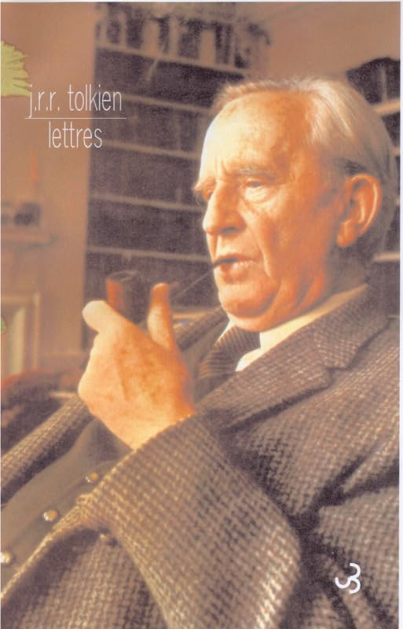
  <figcaption>Couverture de <em>Lettres</em>, J.R.R. Tolkien, éd. Christian Bourgois</figcaption>
</figure>

  

3 janvier 1892Naissance à Bloemfontein (actuelle Afrique du Sud)

  

1937<em>Le Hobbit</em>

  

1954-1955<em>Le Seigneur des Anneaux</em>

  

1969Droits cédés à United Artists, une major de l'époque

  

1973Décès

<!--
Notes orateur (dates À VÉRIFIER et à reporter dans sources.md) :
- 3 janvier 1892 : naissance à Bloemfontein (actuelle Afrique du Sud).
- 21 septembre 1937 : parution du Hobbit.
- 1954-1955 : parution du Seigneur des Anneaux en trois volumes.
- 1969 : Tolkien cède les droits d'adaptation cinéma du Hobbit et du Seigneur des Anneaux à United Artists,
  qui était alors une major hollywoodienne.
- 2 septembre 1973 : décès à Bournemouth (Angleterre).
Naissance, Hobbit et décès confirmés par Tolkiendil (« Tolkien, de l'homme à l'auteur »).
ATTENTION : Tolkiendil (« Le Guide Tolkien ») date la vente des droits de 1968, pas 1969.
-->

---

<!-- _class: crossing -->

<!-- Copie miniature de la slide précédente : à garder identique si elle change -->

<h2>Tolkien en quelques dates</h2>
<figure class="photo">
  
  <figcaption>Couverture de <em>Lettres</em>, J.R.R. Tolkien, éd. Christian Bourgois</figcaption>
</figure>

  

3 janvier 1892Naissance à Bloemfontein (actuelle Afrique du Sud)

  

1937<em>Le Hobbit</em>

  

1954-1955<em>Le Seigneur des Anneaux</em>

  

1969Droits cédés à United Artists, une major de l'époque

  

1973Décès

<h2 class="heading">Et pendant ce temps, en Nouvelle-Zélande…</h2>

<!-- Positions calculées sur 1961-2001, à la même échelle que la frise de Tolkien -->

  

1961Naissance de Peter Jackson

  

1987<em>Bad Taste</em>

  

1994<em>Créatures célestes</em>

<figure class="jackson-photo">
  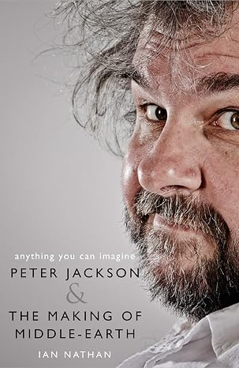
  <figcaption>Couverture de <em>Anything You Can Imagine</em>, Ian Nathan</figcaption>
</figure>

<svg class="junction" width="960" height="720" viewBox="0 0 960 720">
  <line class="guide" x1="373.7" y1="340" x2="373.7" y2="430" />
  <path class="draw" d="M430,283.5 L565,283.5 C595,283.5 585,360 615,360" />
  <path class="draw" d="M565,437 C595,437 585,360 615,360" />
  <path class="draw merged" d="M615,360 L920,360" />
  <g class="film-event">
    <circle cx="680" cy="360" r="8" />
    <text class="year" x="680" y="340">2001</text>
    <text class="film" x="680" y="392">La Communauté</text>
    <text class="film" x="680" y="412">de l'Anneau</text>
  </g>
  <g class="film-event">
    <circle cx="780" cy="360" r="8" />
    <text class="year" x="780" y="340">2002</text>
    <text class="film" x="780" y="392">Les Deux</text>
    <text class="film" x="780" y="412">Tours</text>
  </g>
  <g class="film-event">
    <circle cx="880" cy="360" r="8" />
    <text class="year" x="880" y="340">2003</text>
    <text class="film" x="880" y="392">Le Retour</text>
    <text class="film" x="880" y="412">du Roi</text>
  </g>
</svg>

<!--
Notes orateur :
- Peter Jackson naît le 31 octobre 1961 en Nouvelle-Zélande : il a 11 ans à la mort de Tolkien. (À VÉRIFIER)
- 1987 : Bad Taste, premier long métrage, film gore tourné en amateur. (À VÉRIFIER)
- 1994 : Créatures célestes (Heavenly Creatures), reconnaissance internationale. (À VÉRIFIER)
- Tournage simultané des trois films du 11 octobre 1999 au 22 décembre 2000 (Tolkiendil).
- Sorties en France : 19 décembre 2001, 18 décembre 2002, 17 décembre 2003 (Tolkiendil, page de la trilogie).
  ATTENTION : la page Tolkiendil des Deux Tours indique le 10 décembre 2002 pour la France.
-->

---

<!-- _class: context -->

## 1955 : le Seigneur des Anneaux à la radio

Première adaptation : un feuilleton radiophonique de la BBC.

> Je pense peu de bien des adaptations radiophoniques. À l’exception de quelques détails, je trouve qu’elles sont mal faites, même en acceptant le texte et la légitimité de la démarche (que moi je n’accepte pas).

— J.R.R. Tolkien, lettre 176, 8 décembre 1955

<!--
Notes orateur :
- Première adaptation du Seigneur des Anneaux : un feuilleton radiophonique de la BBC, en 1955.
- Adaptation de Terence Tiller, diffusée en 1955-1956 (Tolkiendil). (À VÉRIFIER)
- Tolkien est déjà de son vivant très réservé sur l'idée même d'adapter son livre :
  il ne conteste pas seulement la qualité, il conteste la « légitimité de la démarche ».
-->

---

<!-- _class: context -->

## 1957-1959 : un projet de dessin animé

Ackerman et Zimmerman proposent un film d'animation. Projet abandonné.

> Le Balrog ne parle ni n’émet jamais avec sa bouche aucun son d’aucune sorte. Moins que tout il ne rit ni ne ricane. […] Z peut penser qu’il en sait plus que moi sur les Balrogs, mais il ne peut pas s’attendre à ce que je sois d’accord en cela avec lui.

— J.R.R. Tolkien, lettre 210

<!--
Notes orateur :
- 1957-1959 : projet de dessin animé porté par Ackerman et Zimmerman, finalement abandonné.
- Forrest Ackerman vient rencontrer Tolkien à Oxford pour présenter le projet (Tolkiendil). (À VÉRIFIER)
- « Z », c'est Morton Grady Zimmerman, l'auteur du scénario. Tolkien le commente point
  par point ; ici, sa remarque n° 20. (À VÉRIFIER)
- Touche d'humour : Tolkien corrige le scénariste sur… le comportement des Balrogs.
- Pourtant Tolkien n'était pas hostile à l'idée d'un dessin animé (citation C01) :
  « En ce qui me concerne, j'accueillerais personnellement volontiers l'idée d'un dessin
  animé, avec tous les risques liés à la vulgarisation [...] même si, à l'orée de la
  retraite, cela n'est pas une éventualité désagréable. »
-->

---

<!-- _class: long-quote -->

## 1969 : le projet avorté de John Boorman

> Boorman avait un goût pour le sensuel et le païen [...] Aragorn ranime Éowyn par un or***** magique, et va même jusqu'à planter un franc baiser sur les lèvres de Boromir à un moment. Le réalisateur se laisse aussi emporter par la réputation du livre comme totem hippie. Les fleurs sauvages sont un leitmotiv omniprésent, et le Conseil d'Elrond se transforme en spectacle de cirque fellinien, avec danseurs, jongleurs et un chien plein d'entrain qui symbolise le destin. [...]
>
> Disparus, les trous de hobbit, Bree et le Gouffre de Helm. Gimli ouvre les portes de la Moria en dansant la gigue, tandis que Merry et Pippin sont joués comme un Laurel et Hardy version Demi-Hommes. [...]
>
> United Artists (UA) n'y comprit pas un traître mot.

— Ian Nathan, *Anything You Can Imagine* (2018)

<!--
Notes orateur :
- Projet de John Boorman en 1969 : les trois livres condensés en un seul film.
- Lire l'extrait à voix haute : l'effet comique tient à l'accumulation (le baiser à Boromir,
  la gigue de Gimli, Merry et Pippin en Laurel et Hardy, le chien qui symbolise le destin).
- Chute : United Artists n'y comprend rien, le projet est abandonné.
-->

---

## Et les Beatles ? (1968-1969)

- Les Beatles veulent une comédie musicale tirée du *Seigneur des Anneaux*, dont ils seraient les vedettes
- Ils vont trouver Stanley Kubrick
- Kubrick les aurait convaincus que le livre est inadaptable

<!--
Notes orateur (Ian Nathan, Anything You Can Imagine) :
« Puis il y avait l'histoire des Beatles. Comment les Fab Four, au sommet de leur propre
gloire invraisemblable, étaient allés trouver le grand Stanley Kubrick dans sa propriété
de St Albans pour qu'il les aide à créer une comédie musicale multimédia tirée du
Seigneur des Anneaux, dont ils seraient les vedettes et dont ils assureraient,
naturellement, la rythmique. »
- Il semblerait que Kubrick ait convaincu les Beatles de l'impossibilité de l'adaptation.
-->

---

## 1978 : la première tentative

  

1969United Artists

  

Boormanabandon

  

MGMabandon

  

Saul Zaentzrachète

  

1978sortie du film

  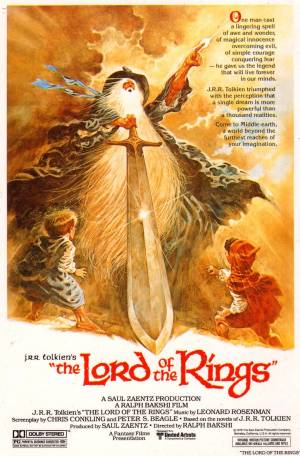
  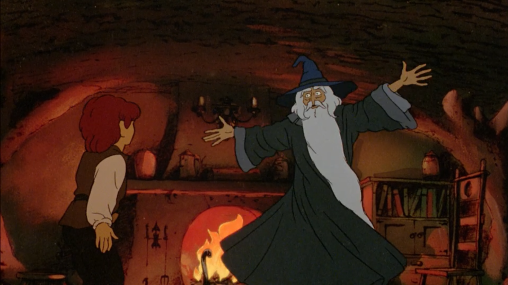
  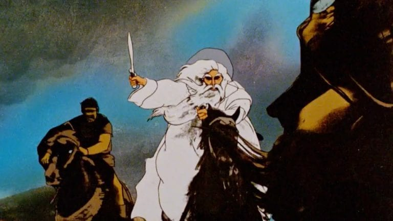

Film d'animation avec utilisation de la rotoscopie (on filme des acteurs, puis on redessine à la main en ajoutant le décor)

<!--
Notes orateur :
- Message : adapter Tolkien au cinéma était déjà un pari risqué, et le parcours du film le montre.
- Bakshi lit dans la presse que United Artists prépare une version de John Boorman qui
  condense les trois livres en un film. Pour lui, « la chose la plus stupide » qu'il ait
  entendue. United Artists abandonne : le patron du studio avoue n'avoir « jamais lu le
  bouquin » et veut surtout récupérer les 3 millions de dollars payés pour le scénario.
- Bakshi convainc la MGM le jour même, puis le dirigeant de la MGM est licencié. Son
  successeur : « Je ne comprends pas le film » et demande si l'histoire « parle d'un
  mariage ».
- Saul Zaentz (producteur enrichi par Fritz le Chat, plus tard Vol au-dessus d'un nid de
  coucou) rachète tout pour financer « les trois films ». United Artists distribue.
- Bakshi va chercher la bénédiction de la famille : Priscilla Tolkien lui fait visiter le
  bureau de son père à Oxford.
- Technique : tout est d'abord tourné avec des acteurs costumés (plateau blanc à
  Los Angeles, château de Belmonte en Espagne pour le Gouffre de Helm), puis redessiné
  (rotoscopie). Pas d'ordinateur à l'époque.
- Anecdotes : Mick Jagger voulait faire la voix de Frodon ; Led Zeppelin était d'accord
  pour la musique, mais un problème de contrat l'a empêché ; les figurants espagnols
  jouant les orques partent manger en pleine prise.
- Bakshi : « J'en suis presque mort. C'était la chose la plus dure que j'ai faite de toute
  ma vie. » (citation candidate C-B1, absente de citations.md)
-->

---

## Un succès inachevé

- L'histoire s'arrête au Gouffre de Helm
- « Première partie » : retiré de l'affiche
- La suite ne sera jamais tournée

Christopher Tolkien la considère : « avec horreur, telle une incroyable parodie du travail de mon père ». Cité par Adam Tolkien (source : Tolkiendil)

<!--
Notes orateur :
- Bakshi demandait 3 ou 4 mois de plus pour le montage ; refusé, la sortie avant Noël était
  fixée. Il considère le film comme « une grossière première ébauche ».
- Une semaine avant la sortie, il découvre que la mention « Première partie » a disparu de
  la campagne de publicité. Le film se termine après le Gouffre de Helm : les spectateurs
  ne voient jamais Frodon détruire l'Anneau, les fans se sentent floués, les autres
  restent perplexes.
- Les critiques sont sévères : film jugé confus, rotoscopie vue comme une « triche ».
  Christopher Tolkien considère le film « avec horreur, telle une incroyable parodie du
  travail de mon père ».
- Pas de suite : Bakshi se brouille avec Zaentz et refuse de faire la deuxième partie ;
  selon une autre source, United Artists refuse de financer une suite malgré le succès.
  Les deux versions sont compatibles.
- En 1980, un téléfilm d'animation de Rankin et Bass, The Return of the King, raconte la
  fin, présenté comme une suite non officielle, avec un style graphique totalement
  différent. (À VÉRIFIER)
- Transition vers Jackson : les leçons de cet échec (une histoire en trois films, tournés
  d'un bloc, sans sortie bâclée). (À VÉRIFIER : interprétation à valider par l'auteur)
-->

---

<!-- _class: section -->

## 2. La carrière de Peter Jackson

---

## Un bricoleur passionné

- Enfant : une caméra Super 8 et *King Kong*
- 1987 : *Bad Taste*, tourné le week-end, entre amis
- Masques et effets fabriqués à la maison

  

<!--
Notes orateur :
- Message : dès l'enfance, Jackson fabrique lui-même ses effets spéciaux, avec trois fois rien.
- Né en 1961 en Nouvelle-Zélande (déjà sur la slide « croisement »). Enfant, il reçoit une
  caméra Super 8 et tourne ses propres films avec les copains du quartier. (À VÉRIFIER)
- Le déclic : King Kong (1933), vu enfant à la télévision ; il tente d'en tourner sa
  propre version, avec un gorille en maquette. Son admiration pour Ray Harryhausen,
  maître de l'animation image par image. (À VÉRIFIER)
- Pas d'école de cinéma : il quitte l'école et travaille comme photograveur dans un journal
  de Wellington. (À VÉRIFIER)
- Bad Taste (1987) : film d'extraterrestres gore et comique, tourné pendant environ
  quatre ans, les week-ends, avec des amis. Jackson joue deux rôles, et cuit les masques
  en latex dans le four de sa mère. (À VÉRIFIER) Touche d'humour.
- Le film est remarqué au marché du Festival de Cannes (1988) et vendu dans de nombreux
  pays. (À VÉRIFIER)
- Citation candidate C-J1 (absente de citations.md) : Jackson dit que filmer des maquettes
  est l'un des grands plaisirs, et que dans une autre carrière il construirait des
  maquettes pour le cinéma (American Cinematographer).
-->

---

## Weta, l'atelier maison

- Richard Taylor et Tania Rodger : maquettes, prothèses, costumes
- *Les Feebles* (1989), *Braindead* (1992)
- *Créatures célestes* (1994) : naissance de Weta Digital
- *Fantômes contre fantômes* (1996) : produit par Universal, avec Michael J. Fox

<!--
Notes orateur :
- Message : autour de Jackson naît une petite entreprise d'effets spéciaux qui deviendra
  l'une des meilleures du monde.
- Weta Workshop est fondée par Richard Taylor et Tania Rodger, spécialisée dans les
  prothèses, maquettes, animatroniques et costumes.
- Le nom : « Wingnut Entertainment Technical Allusions », et surtout le weta, un insecte
  néo-zélandais particulièrement résistant.
- Premier projet avec Jackson : Braindead, repoussé faute de financement ; entre-temps,
  ils travaillent sur Les Feebles (1989), comédie avec des marionnettes, qualifiée de l'un
  des films « les plus gores » jamais tournés. Braindead sort finalement en 1992. (À VÉRIFIER)
- Weta travaille aussi pour la télévision : Hercule et Xena, la princesse guerrière (1995).
- Créatures célestes (1994), drame coécrit avec Fran Walsh, d'après un fait divers :
  changement de registre complet, reconnaissance internationale. Pour ses effets
  numériques est créée Weta Digital. Premier rôle au cinéma de Kate Winslet ; nomination à
  l'Oscar du meilleur scénario original. (À VÉRIFIER)
- Fantômes contre fantômes (The Frighteners, 1996), produit par un studio hollywoodien
  (Universal), avec Michael J. Fox : des centaines de plans numériques, réalisés en
  Nouvelle-Zélande. (À VÉRIFIER, sauf la participation de Weta) C'est la répétition
  générale du Seigneur des Anneaux.
- Fran Walsh, sa compagne, coscénariste de presque tous ses films, coscénariste de la
  trilogie et oscarisée avec lui. (À VÉRIFIER, sauf l'Oscar)
- Pour la suite : sur la trilogie, Weta prendra en charge les miniatures, les armes et
  armures, les créatures, les prothèses et le maquillage, et Richard Taylor remportera
  plusieurs Oscars (effets visuels, maquillage, costumes).
-->

---

## Recherche d'un grand projet

- Renommée internationale depuis *Créatures célestes*
- Une expérience des effets spéciaux
- L'envie d'un grand projet fantastique
- Repéré par Miramax, distributeur de *Créatures célestes* aux États-Unis

<!--
Notes orateur :
- Jackson a une renommée internationale depuis Créatures célestes et une expérience des
  effets spéciaux. Il souhaite réaliser un grand projet dans le fantastique au sens large.
- Miramax l'a repéré : c'est le distributeur de Créatures célestes aux États-Unis.
- Saul Zaentz détient toujours ces droits depuis le film de Bakshi : encore lui.
- Point important : la conception artistique et la négociation contractuelle se font
  en parallèle.
- Deal initial : deux films pour 75 M$. Pour comparer, Fantômes contre fantômes, le film
  précédent de Jackson, avait un budget de 28 M$.
-->

---

## Pourquoi pas Tolkien ?

  

1978il voit le film de Bakshi, puis lit le livre

  

1996<em>King Kong</em> : projet annulé

  

Weta est prêtepourquoi pas Tolkien ?

  

<!--
Notes orateur :
- Après Fantômes contre fantômes, Jackson a acquis une reconnaissance internationale et
  cherche un gros projet. Il a toujours un fort goût pour le fantastique et les effets
  spéciaux.
- Message : Jackson arrive au Seigneur des Anneaux par deux chemins : un souvenir de
  jeunesse (le film de Bakshi) et un projet avorté (King Kong).
- Adolescent, Jackson voit le film de Ralph Bakshi en 1978, veut savoir comment l'histoire
  finit, et achète le livre en poche pour le lire dans le train. (À VÉRIFIER)
  Lien direct avec « Un succès inachevé » : la fin manquante du film de Bakshi a poussé le
  futur réalisateur vers le livre.
- Weta fait un important travail de préproduction pour un remake de King Kong ; le projet
  est annulé, notamment à cause de la concurrence du Godzilla de 1998. Jackson le
  réalisera après la trilogie (2005).
- Aussitôt après, Jackson propose à Weta un nouveau projet : Le Seigneur des Anneaux.
  Pour l'obtenir, il faut passer par Saul Zaentz, qui détient toujours les droits depuis
  le film de Bakshi. (À VÉRIFIER) Encore un écho avec la partie précédente.
- Transition : Miramax, deux films, puis un seul, puis New Line et la trilogie.
-->

---

<!-- _class: divergence -->

## Divergences avec Miramax

<svg class="schema" width="960" height="720" viewBox="0 0 960 720">
  <defs>
    <marker id="divergence-arrow" markerUnits="userSpaceOnUse" markerWidth="18" markerHeight="18" refX="16" refY="9" orient="auto">
      <path d="M0,0 L18,9 L0,18 Z" />
    </marker>
  </defs>
  <path class="arrow" d="M310,350 C450,350 450,265 625,265" marker-end="url(#divergence-arrow)" />
  <path class="arrow" d="M310,410 C450,410 450,495 625,495" marker-end="url(#divergence-arrow)" />
  <g class="box">
    <rect x="70" y="295" width="240" height="170" />
    <text class="who" x="190" y="350">Deal initial</text>
    <text x="190" y="400">2 films</text>
    <text x="190" y="440">75 M$</text>
  </g>
  <g class="box">
    <rect x="630" y="180" width="240" height="170" />
    <text class="who" x="750" y="235">Peter Jackson</text>
    <text x="750" y="285">2 films</text>
    <text class="changed" x="750" y="325">130 M$</text>
  </g>
  <g class="box">
    <rect x="630" y="410" width="240" height="170" />
    <text class="who" x="750" y="465">Miramax</text>
    <text class="changed" x="750" y="515">1 film</text>
    <text x="750" y="555">75 M$</text>
  </g>
</svg>

<!--
Notes orateur :
- On part du deal initial : deux films pour 75 M$.
- Côté Jackson, le budget monte : le producteur Tim Sanders, venu à sa demande pour
  établir un budget, estime les deux films à 130 à 135 M$.
- Côté Miramax, l'enveloppe ne bouge pas : 75 M$, mais un seul film.
-->

---

<!-- _class: quote -->

## À quoi vous avez échappé…

Miramax, également en contact avec Quentin Tarantino, menaça plusieurs fois de lui confier le projet : cela donnerait « la p***** de Terre du Milieu de Quentin Tarantino ».

— d'après Ian Nathan, *Anything You Can Imagine* (2018), p. 67

<!--
Notes orateur :
- La menace : confier le film à Quentin Tarantino si Jackson refuse la version en un seul
  film. (À VÉRIFIER)
- Citation : traduction par l'IA de l'original anglais.
-->

---

<!-- _class: context -->

## À quoi vous avez échappé… (suite)

> [Miramax avait] une approche plus radicale et plus resserrée, qui conservait des « éléments clés » mais en sacrifiait encore beaucoup d'autres. Parmi ses péchés manifestes, le Gouffre de Helm était supprimé, Théoden et Denethor fusionnés ([...] le Rohan et le Gondor aussi) et Éowyn prenait la place de Faramir pour devenir la sœur de Boromir, tandis que le mémo hésitait à supprimer le problématique Saroumane ou à le faire participer à la bataille des Champs du Pelennor.

— Ian Nathan, *Anything You Can Imagine* (2018), p. 68, à propos du mémo du 17 juin 1998

<!--
Notes orateur :
- Le mémo est signé Jack Lechner, responsable du développement chez Miramax.
- Pour ceux qui n'ont pas lu le livre : Théoden est le roi du Rohan, Denethor l'intendant
  du Gondor, deux royaumes bien distincts. (À VÉRIFIER)
- Citation : traduction par l'IA de l'original anglais.
-->

---

<!-- _class: context dense -->

## Le clash

> « J'avais pris trop de coups », dit Jackson. Il appela Kamins1. « Dis simplement à Harvey qu'on ne peut pas le faire. On préfère avoir notre vie, faire nos films et ne plus avoir à gérer toutes ces conneries. Dis à Harvey de faire son film et bonne chance. »
>
> « Vous avez quatre semaines », dit Harvey2 à Kamins. « Si vous montez le projet ailleurs, je récupère tout mon argent immédiatement, à la signature. Pas au premier jour de tournage. Je récupère tout à la signature. Et je touche cinq pour cent des recettes brutes dès le premier dollar, sur toute la ligne. »

— Ian Nathan, *Anything You Can Imagine* (2018), p. 70

1 Ken Kamins est l'agent de Peter Jackson.

2 Harvey Weinstein, désormais plus connu pour autre chose que la production de films, l'un des dirigeants de Miramax.

<!--
Notes orateur :
- Qui est Ken Kamins ? Agent artistique américain, passé notamment par l'agence ICM
  (International Creative Management).
- Il rencontre Peter Jackson en 1992 et devient son agent. Il l'accompagne ensuite pendant
  toute la genèse du projet Le Seigneur des Anneaux.
- Il devient par la suite son manager et producteur exécutif, notamment sur la trilogie du
  Hobbit. Il dirige sa propre société de management et de production, Key Creatives.
- Citation : traduction par l'IA de l'original anglais.
-->

---

<!-- _class: shaye -->

## New Line et Robert Shaye

<figure>
  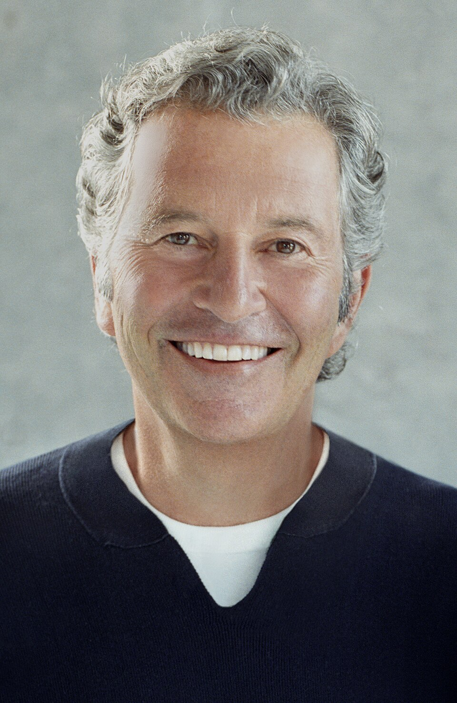
  <figcaption>Robert Shaye. Photo : Wikimedia Commons, CC BY-SA 3.0, auteur non précisé, transmise par Jonna Smith</figcaption>
</figure>

Robert Shaye resta totalement impassible pendant les 35 minutes de la vidéo de démo, puis :

<blockquote>

« Alors là, je ne comprends pas du tout, poursuivit Shaye. Pourquoi faire deux films quand il y a trois livres ? »

Shaye n'en avait pas encore fini. « Tolkien a fait votre travail à votre place, Tolkien a écrit trois livres, insista-t-il. Si vous voulez lui rendre justice, il faut trois films. »

</blockquote>

— Ian Nathan, <em>Anything You Can Imagine</em> (2018), p. 83

<!--
Notes orateur :
- Entre les conditions de Miramax et celles de Jackson (180 millions pour deux films),
  Jackson se retrouve avec seulement deux pistes : Polygram et New Line.
- Mark Ordesky est fan de Tolkien et travaille pour New Line.
- Robert Shaye, dit Bob, est le fondateur de New Line.
- Résultat : New Line rachète les droits et le travail de Weta à Miramax, et finance une
  trilogie. (Tolkiendil)
- Citation : traduction par l'IA de l'original anglais.
-->

---

<!-- _class: section -->

## 3. Le tournage

---

## Un pari risqué et audacieux

- Un budget très important : 280 M$
- Trois films tournés en même temps (oct. 1999 – déc. 2000)
- En Nouvelle-Zélande, sans grande industrie du cinéma
- Weta, jamais à cette échelle
- À la clé : motion capture, foules simulées

<!--
Notes orateur :
- Message : tout, dans ce projet, était un risque.
- Budget : 280 M$ pour les trois films. À titre de comparaison, Harry Potter à l'école des
  sorciers (2001) a un budget estimé de 125 M$.
- Les trois films sont tournés en même temps, d'octobre 1999 à décembre 2000.
- La Nouvelle-Zélande n'avait pas une industrie cinématographique très développée.
- Weta Workshop et Weta Digital n'avaient pas l'habitude de gérer des projets de cette ampleur.
- À la clé, plusieurs innovations techniques : Andy Serkis, le motion capture et Gollum ;
  Massive, un logiciel de simulation d'armées et de grandes foules.
-->

---

<!-- _class: cameos -->

<h2>Alan Lee et John Howe à l'écran</h2>

<figure class="portrait left">
  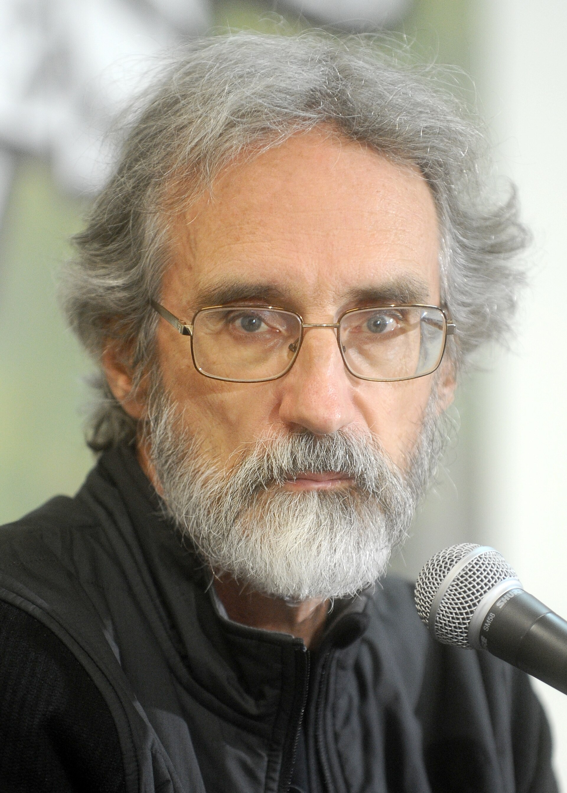
  <figcaption>John Howe</figcaption>
</figure>

<figure class="portrait right">
  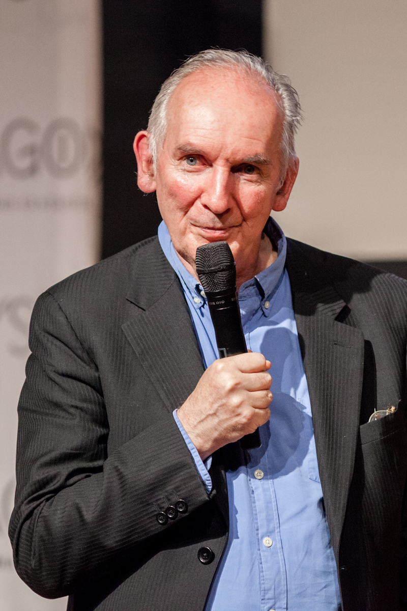
  <figcaption>Alan Lee</figcaption>
</figure>

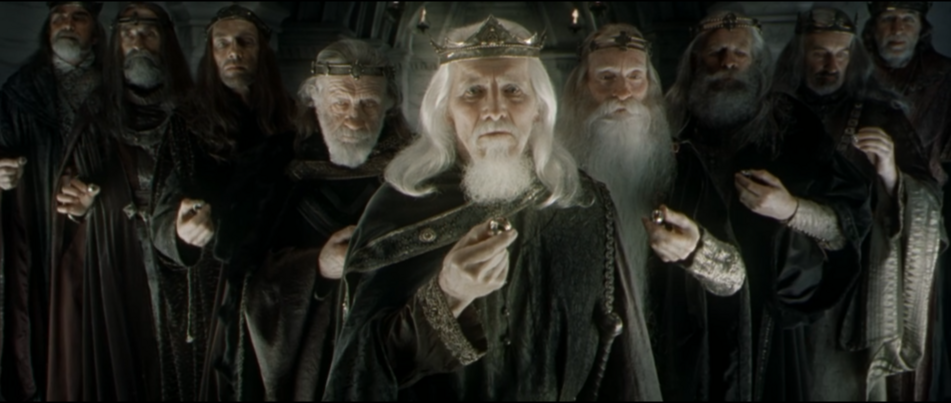

<!-- Coordonnées : image 951×403 affichée en 840×356 à (60, 340), soit un facteur 0,883 -->
<svg class="arrows" width="960" height="720" viewBox="0 0 960 720">
  <defs>
    <marker id="arrowhead" markerUnits="userSpaceOnUse" markerWidth="14" markerHeight="14" refX="12" refY="7" orient="auto">
      <path d="M0,0 L14,7 L0,14 Z" />
    </marker>
  </defs>
  <circle cx="188" cy="392" r="48" />
  <circle cx="793" cy="389" r="48" />
  <path d="M150,272 C150,305 185,305 188,339" marker-end="url(#arrowhead)" />
  <path d="M825,272 C825,302 795,302 793,336" marker-end="url(#arrowhead)" />
</svg>

<!--
Notes orateur :
- Dans le prologue de La Communauté de l'Anneau, parmi les neuf rois des Hommes qui
  reçoivent leurs anneaux : John Howe (2e en partant de la gauche) et Alan Lee
  (2e en partant de la droite).
-->

---

<!-- _class: annexe cameos -->

<h2>Alan Lee et John Howe à l'écran</h2>

<figure class="portrait left">
  
  <figcaption>John Howe</figcaption>
</figure>

<figure class="portrait right">
  
  <figcaption>Alan Lee</figcaption>
</figure>

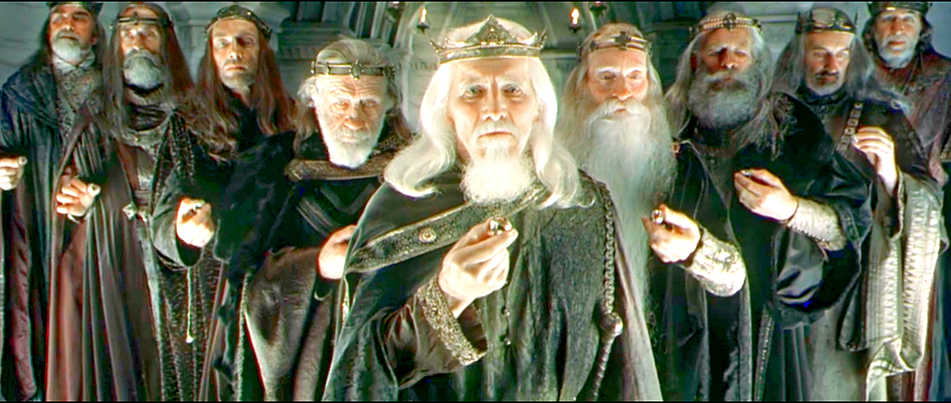

<!-- Annexe : même slide, image éclaircie et plus contrastée pour un vidéoprojecteur faible -->
<svg class="arrows" width="960" height="720" viewBox="0 0 960 720">
  <defs>
    <marker id="arrowhead-clair" markerUnits="userSpaceOnUse" markerWidth="14" markerHeight="14" refX="12" refY="7" orient="auto">
      <path d="M0,0 L14,7 L0,14 Z" />
    </marker>
  </defs>
  <circle cx="188" cy="392" r="48" />
  <circle cx="793" cy="389" r="48" />
  <path d="M150,272 C150,305 185,305 188,339" marker-end="url(#arrowhead-clair)" />
  <path d="M825,272 C825,302 795,302 793,336" marker-end="url(#arrowhead-clair)" />
</svg>

<!--
Notes orateur :
- Version de secours de la slide précédente, image éclaircie pour un vidéoprojecteur faible.
- Dans le prologue de La Communauté de l'Anneau, parmi les neuf rois des Hommes qui
  reçoivent leurs anneaux : John Howe (2e en partant de la gauche) et Alan Lee
  (2e en partant de la droite).
-->

---

<!-- _class: mosaic -->

## Cul-de-Sac

  <figure class="tall">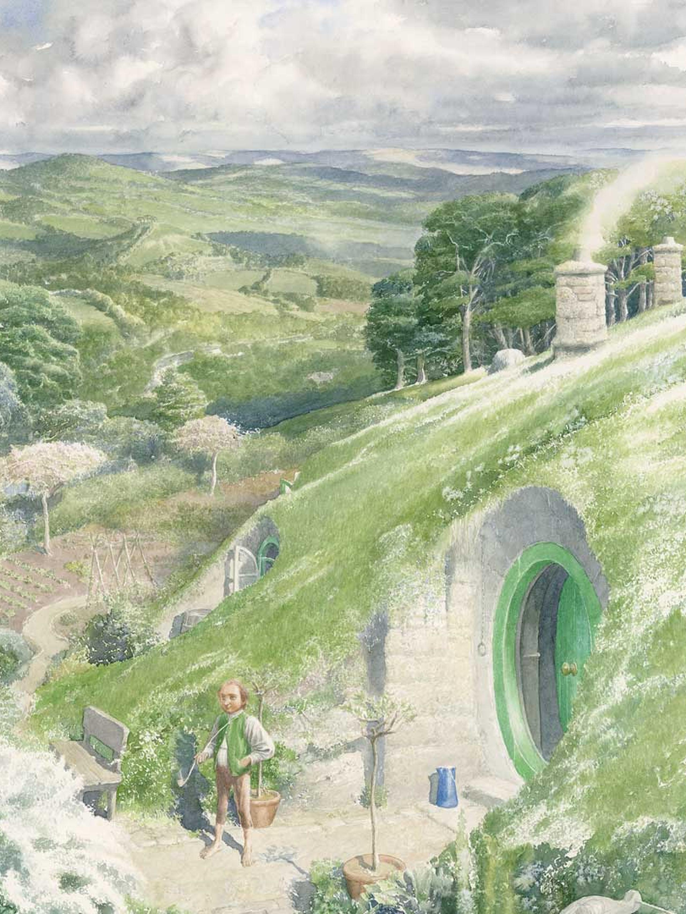<figcaption>Alan Lee</figcaption></figure>
  

    <figure>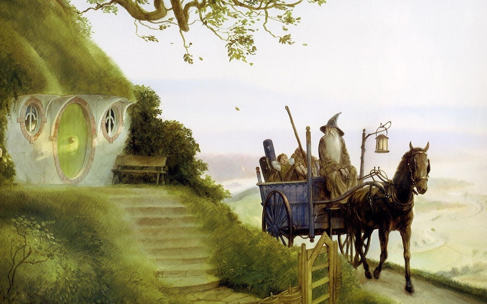<figcaption>John Howe</figcaption></figure>
    <figure>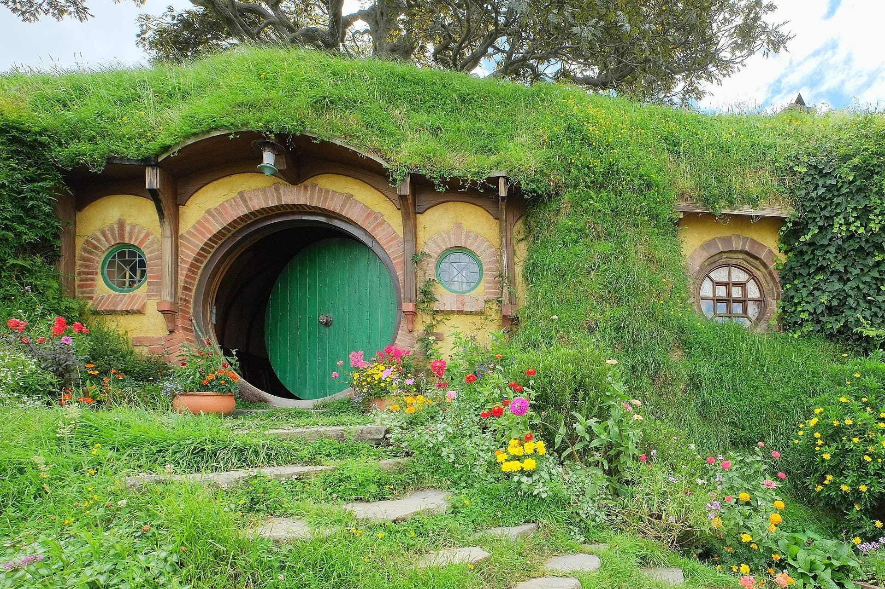<figcaption>Le film</figcaption></figure>
  

<!--
Notes orateur : la même porte ronde, de l'illustration au décor.
-->

---

<!-- _class: wide -->

## Minas Tirith

  <figure>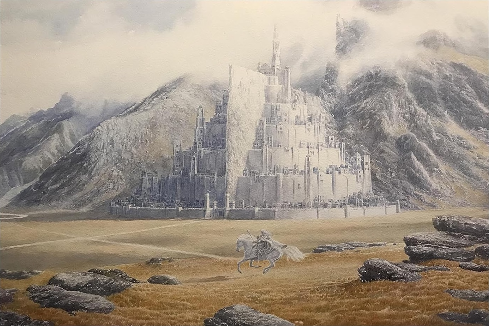<figcaption>Alan Lee, illustration publiée en 1992</figcaption></figure>
  <figure>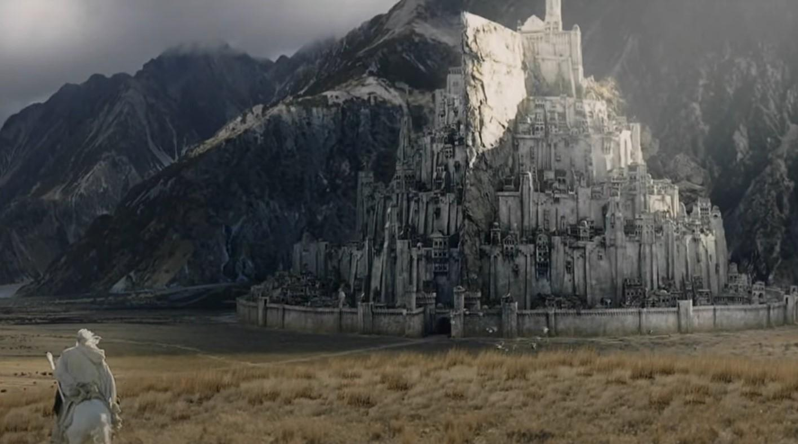<figcaption>Le film</figcaption></figure>

<!--
Notes orateur :
- Minas Tirith vue par Alan Lee, puis dans le film.
- L'illustration d'Alan Lee a été publiée en 1992.
-->

---

## Et le Tolkien Estate dans tout cela ?

- Peter Jackson propose à Christopher Tolkien d'être consultant
- Il décline : pas question de rendre la trilogie officielle

<!--
Notes orateur :
- Peter Jackson avait contacté Christopher Tolkien pour lui demander de travailler comme
  consultant sur les films.
- Christopher Tolkien a décliné, pour ne pas rendre la trilogie de Peter Jackson officielle.
-->

---

<!-- _class: cast -->

## Le casting

<h3>La Communauté</h3>

  <figure>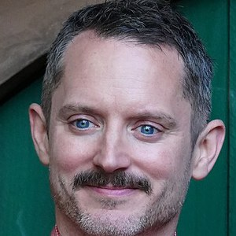<figcaption><b>Frodon</b>Elijah Wood</figcaption></figure>
  <figure>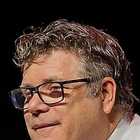<figcaption><b>Sam</b>Sean Astin</figcaption></figure>
  <figure>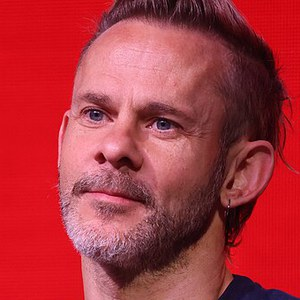<figcaption><b>Merry</b>Dominic Monaghan</figcaption></figure>
  <figure>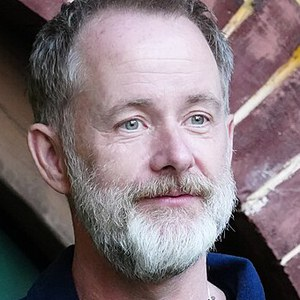<figcaption><b>Pippin</b>Billy Boyd</figcaption></figure>
  <figure>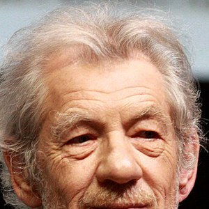<figcaption><b>Gandalf</b>Ian McKellen</figcaption></figure>
  <figure>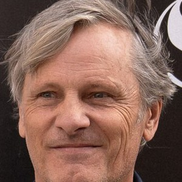<figcaption><b>Aragorn</b>Viggo Mortensen</figcaption></figure>
  <figure>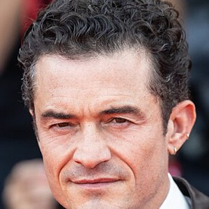<figcaption><b>Legolas</b>Orlando Bloom</figcaption></figure>
  <figure>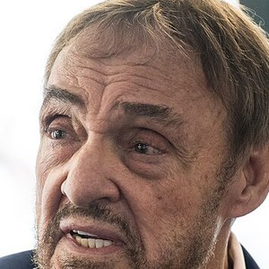<figcaption><b>Gimli</b>John Rhys-Davies</figcaption></figure>
  <figure>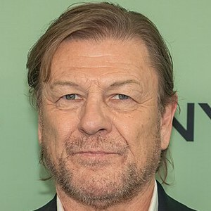<figcaption><b>Boromir</b>Sean Bean</figcaption></figure>

<h3>Et aussi</h3>

  <figure>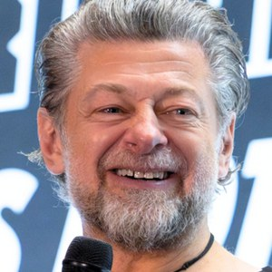<figcaption><b>Gollum</b>Andy Serkis</figcaption></figure>
  <figure>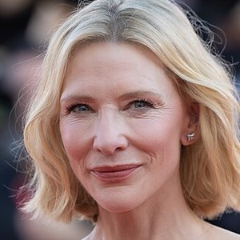<figcaption><b>Galadriel</b>Cate Blanchett</figcaption></figure>
  <figure>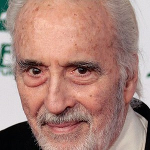<figcaption><b>Saroumane</b>Christopher Lee</figcaption></figure>
  <figure>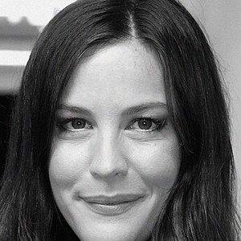<figcaption><b>Arwen</b>Liv Tyler</figcaption></figure>

Photos recadrées : Wikimedia Commons, licences CC BY-SA, CC0 et domaine public. Auteurs dans les notes.

<!--
Notes orateur : les neuf membres de la Communauté, puis Gollum, Galadriel, Saroumane et
Arwen, soit treize acteurs.

Crédits photos (Wikimedia Commons) : Elijah Wood et Billy Boyd, Miguel Discart & Kiri Karma
(CC BY-SA 4.0) ; Sean Astin, John Manard (CC BY-SA 4.0) ; Dominic Monaghan, Gage Skidmore
(CC BY-SA 3.0) ; Ian McKellen, Gage Skidmore (CC BY-SA 2.0) ; Viggo Mortensen, AWFF Oficial
(CC BY-SA 2.0) ; Orlando Bloom et Cate Blanchett, Harald Krichel (CC BY-SA 4.0) ;
John Rhys-Davies, NASA, Aubrey Gemignani (domaine public) ; Sean Bean, Bryan Berlin
(CC BY-SA 4.0) ; Andy Serkis, Fandomuniverse (CC0) ; Christopher Lee, Manfred Werner
(CC BY-SA 3.0) ; Liv Tyler, Walterlan Papetti (CC BY-SA 4.0).
-->

---

<!-- _class: anecdotes trois -->

## Quelques anecdotes de casting

  <figure>
    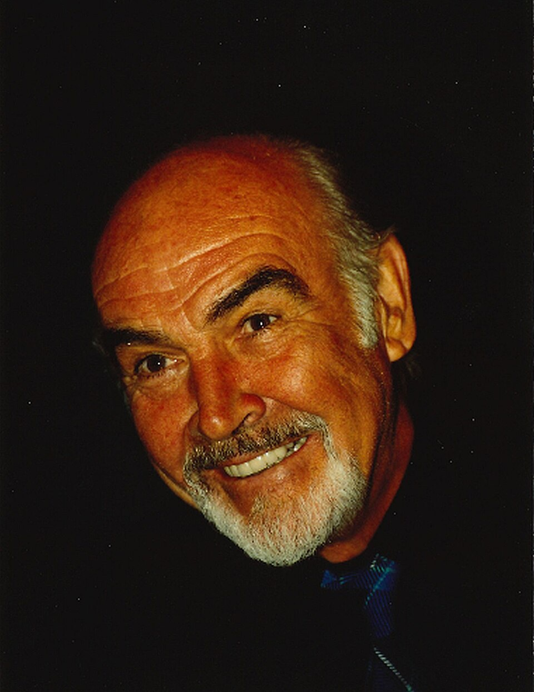
    <figcaption>Photo : John Mathew Smith, Wikimedia Commons, CC BY-SA 2.0</figcaption>
    
New Line voulait Sean Connery pour jouer Gandalf

  </figure>
  <figure>
    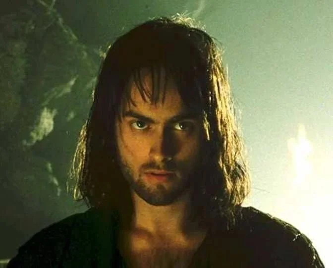
    <figcaption>Stuart Townsend en Aragorn</figcaption>
    
Stuart Townsend, choisi par Peter Jackson, est remplacé par Viggo Mortensen

  </figure>
  <figure>
    
    <figcaption>Photo : Manfred Werner (Tsui), Wikimedia Commons, CC BY-SA 3.0</figcaption>
    
Christopher Lee voulait au départ jouer Gandalf

  </figure>

<!--
Notes orateur :
- New Line voulait Sean Connery pour jouer Gandalf.
- Il y a eu un loupé sur Aragorn : Peter Jackson avait sélectionné Stuart Townsend, qui n'a
  pas fait l'affaire, et il a été remplacé par Viggo Mortensen.
- Christopher Lee voulait au départ jouer Gandalf ; il sera Saroumane.
-->

---

<!-- _class: anecdotes -->

## Quelques anecdotes de casting (suite)

  <figure>
    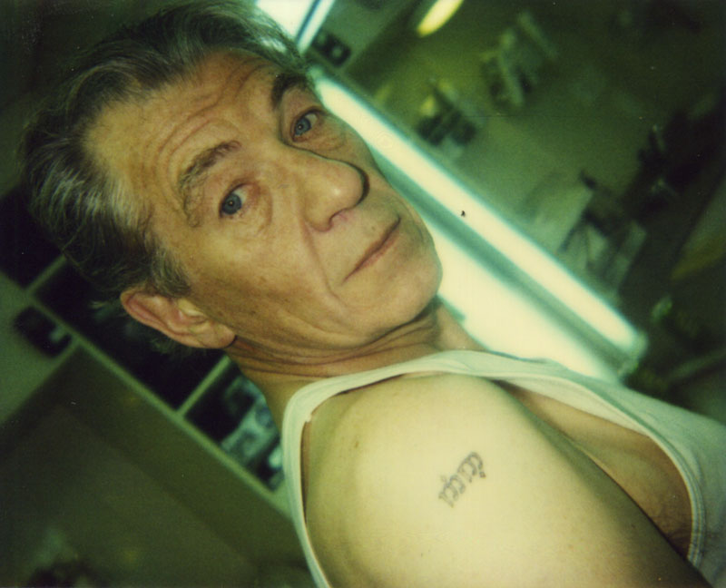
    <figcaption>Ian McKellen. Photo : mckellen.com</figcaption>
  </figure>
  <figure>
    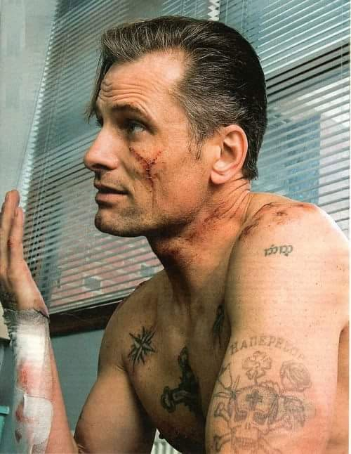
    <figcaption>Viggo Mortensen. Source à compléter</figcaption>
  </figure>

Les acteurs de la Communauté se sont fait tatouer le chiffre 9 en écriture elfique

<!--
Notes orateur : les acteurs de la Communauté de l'Anneau se sont fait tatouer le chiffre 9
en écriture elfique.
-->

---

<!-- _class: map -->

## Les lieux de tournage en Nouvelle-Zélande

Fond de carte : Natural Earth (domaine public)

<!--
Notes orateur :
- Hobbitebourg : Matamata (vallée de Hinuera), île du Nord.
- Montagne du Destin : le mont Ngauruhoe, parc national de Tongariro.
- Gouffre de Helm : la carrière de Dry Creek, Haywards Hill Road, Lower Hutt, près de Wellington.
- Fendeval : le parc régional de Kaitoke, près de Wellington.
- Sud de Fendeval : le mont Olympus, parc national de Kahurangi, au nord de l'île du Sud.
- Vallée de Ruisselombre (la sortie de la Moria) : le mont Owen, parc national de Kahurangi.
- Edoras : Mount Sunday, dans la région de Canterbury.
- Argonath : la rivière Kawarau, près de Queenstown ; les statues sont ajoutées numériquement.
-->

---

<!-- _class: context dense -->

## Ainsi qu'une météo capricieuse

Une tempête inonde des lieux de tournage. Sean Bean et Orlando Bloom sont coincés entre deux glissements de terrain.

> Par chance, Legolas et Boromir repèrent une minuscule maisonnette, isolée sur la lande sauvage, dont l'unique occupante est une vieille dame qui n'a pas la moindre idée de qui ils sont. Ils lui expliquent leur mésaventure et elle les invite à entrer, d'abord pour le thé, puis pour rester. [...]
>
> Restait aussi le petit problème de savoir comment récupérer Bloom et Bean, en exil dans une maisonnette magique. Les routes n'étant toujours pas dégagées, ils dormaient depuis quatre jours sur les minuscules canapés de la vieille dame quand Caro finit par négocier un sauvetage en hélicoptère.

— Ian Nathan, *Anything You Can Imagine* (2018), p. 198

<!--
Notes orateur :
- Une prodigieuse tempête a inondé certains lieux de tournage ; Sean Bean et Orlando Bloom se
  sont retrouvés coincés sur une route, encerclés par deux glissements de terrain.
- Pour la petite histoire, Jackson raconte en riant que Sean Bean déteste les hélicoptères :
  le vol jusqu'à Queenstown, dans les restes de la tempête, l'a laissé presque inconscient.
- Citation : traduction par l'IA de l'original anglais.
-->

---

<!-- _class: visual -->

## Et des contraintes locales

<figure>
  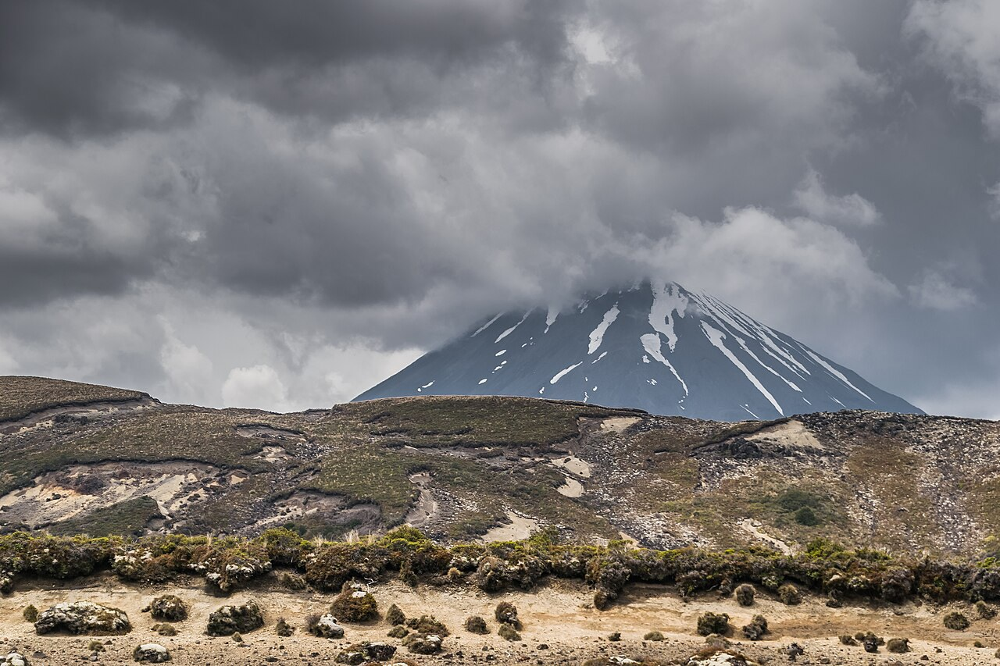
  <figcaption>Le mont Ngauruhoe. Photo : Krzysztof Golik, Wikimedia Commons, CC BY-SA 4.0</figcaption>
</figure>

Sacré pour les Maoris : impossible d'y tourner

<!--
Notes orateur :
- Le volcan choisi pour servir de référence à la montagne du Destin était le mont Ngauruhoe.
- Il est sacré pour les Maoris : il n'a pas été possible de tourner dessus.
-->

---

<!-- _class: context dense -->

## Un tournant dans les effets spéciaux numériques

- Des effets spéciaux numériques en plein essor
- Mais utilisés seulement en cas de nécessité

> « Brian a mis en place une grande partie des mouvements à l'échelle des Hobbits et des dispositifs de contrôle de mouvement. Soixante à soixante-dix pour cent de ces plans ont été réalisés directement à la prise de vue, le reste étant des compositings sur fond bleu. »

— Jim Rygiel, à propos de Brian Van't Hul, dans Ron Magid, « Imagining Middle-Earth for *The Lord of the Rings* », *American Cinematographer*, décembre 2001, republié sur theasc.com le 29 janvier 2026

<!--
Notes orateur :
- Les effets spéciaux numériques se développaient fortement, mais le film gardait la volonté de n'en
  utiliser qu'en cas de nécessité.
- Attention à la portée du chiffre : il concerne les plans où les acteurs doivent paraître à
  la taille de Hobbits, dans La Communauté de l'Anneau, pas tout le film. Rygiel oppose la
  prise de vue au compositing sur fond bleu, il ne parle pas de CGI.
- Citation : traduction par l'IA de l'original anglais.
-->

---

<!-- _class: visual stack -->

## Une image assez emblématique

<figure>
  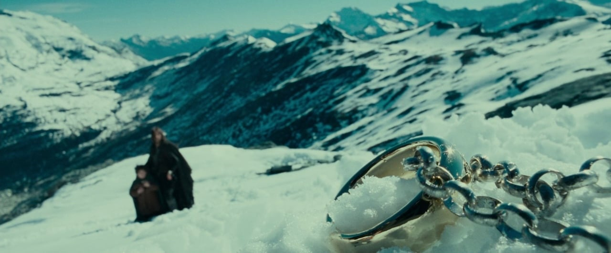
  <figcaption><em>La Communauté de l'Anneau</em>. Source : Ron Magid, <em>American Cinematographer</em>, décembre 2001, theasc.com</figcaption>
</figure>

<figure>
  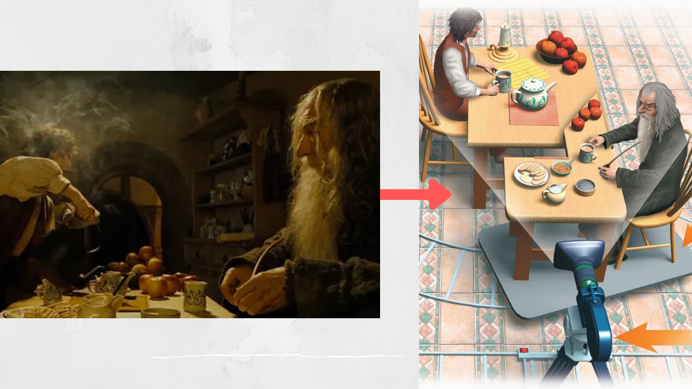
  <figcaption>La perspective forcée. Source : over-blog-kiwi.com</figcaption>
</figure>

<!--
Notes orateur :
- L'Anneau dans la neige : image issue du même article d'American Cinematographer.
- La perspective forcée : la scène de Cul-de-Sac et le dispositif de tournage.
-->

---

## Deux studios complémentaires

- **Weta Workshop** : le maquillage, les accessoires
- **Weta Digital** : les effets spéciaux numériques

<!--
Notes orateur :
- Weta Workshop pour le maquillage et les accessoires.
- Weta Digital pour les effets spéciaux numériques.
-->

---

<!-- _class: visual -->

## Utilisation de Massive

<figure>
  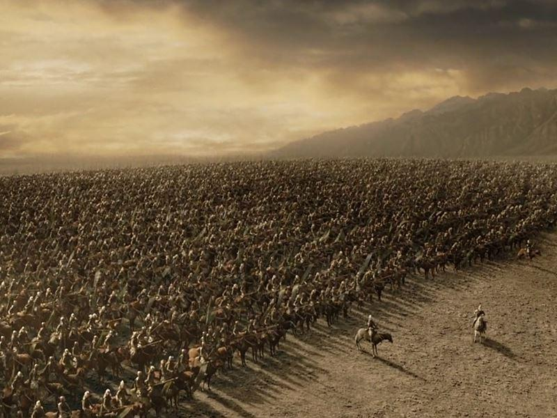
</figure>

<!--
Notes orateur : Massive, un logiciel de simulation d'armées et de grandes foules.
-->

---

<!-- _class: annexe visual -->

## Utilisation de Massive

<figure>
  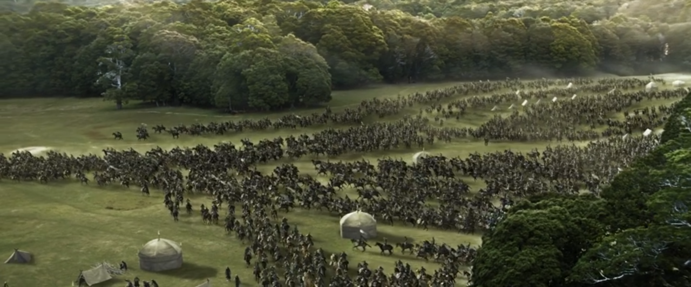
  <figcaption>L'armée du Rohan</figcaption>
</figure>

<!--
Notes orateur : annexe, l'armée du Rohan.
-->

---

<!-- _class: annexe visual -->

## Utilisation de Massive

<figure>
  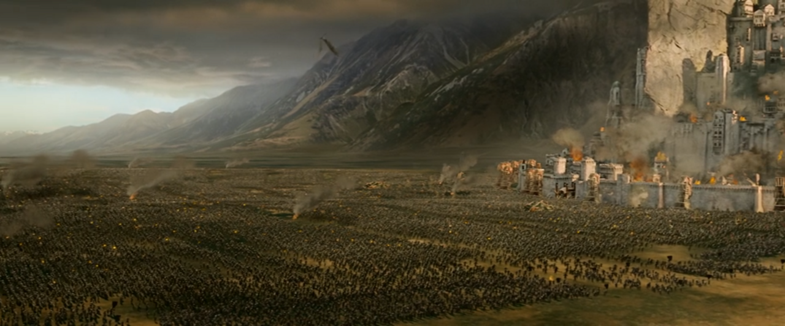
  <figcaption>Les Champs du Pelennor</figcaption>
</figure>

<!--
Notes orateur : annexe, les Champs du Pelennor.
-->

---

<!-- _class: visual -->

## Le motion capture et Andy Serkis : une avancée artistique

<figure>
  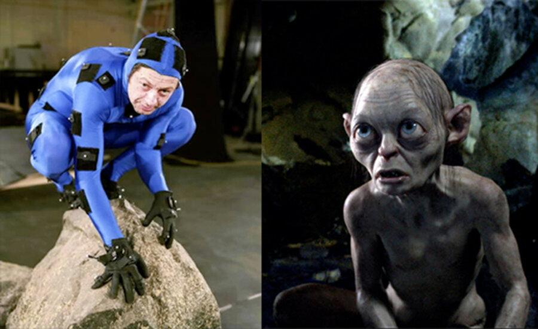
</figure>

<!--
Notes orateur : Andy Serkis, le motion capture et Gollum.
-->

---

<!-- _class: section -->

## Conclusion

---

<!-- _class: awards -->

## Un succès cinématographique reconnu…

Environ 3 milliards de dollars au box-office

| Film | Oscars | Catégories |
|------|--------|------------|
| *La Communauté de l'Anneau* | 4 | Photographie, effets visuels, maquillage, musique |
| *Les Deux Tours* | 2 | Montage de son, effets visuels |
| *Le Retour du Roi* | 11 | Film, réalisateur, scénario adapté, direction artistique, costumes, montage, maquillage, musique, chanson originale, mixage de son, effets visuels |
| **Total** | **17** | |

<!--
Notes orateur :
- Cérémonies de 2002, 2003 et 2004. Alan Lee est récompensé pour la direction artistique
  du Retour du Roi.
- C'est le début d'un univers visuel large : jeux vidéo, suite du Hobbit.
- Richard Taylor et Jim Rygiel ont chacun reçu 3 Oscars : 3 fois les effets visuels pour
  Jim Rygiel, 2 fois le maquillage et 1 fois les effets visuels pour Richard Taylor.
  ATTENTION : Tolkiendil donne en plus à Richard Taylor l'Oscar des costumes pour Le Retour
  du Roi, soit 4 Oscars.
-->

---

<!-- _class: wide -->

## Qui a engendré un univers multimédia étendu…

  <figure>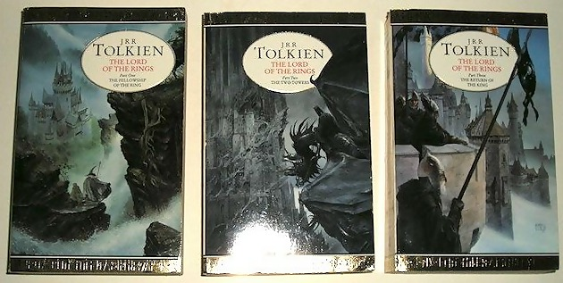<figcaption>Avant les films</figcaption></figure>
  <figure>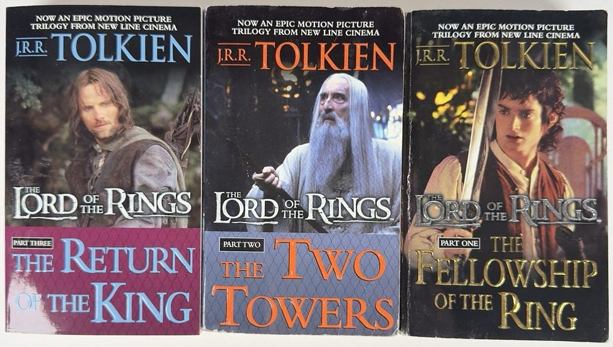<figcaption>Après les films</figcaption></figure>

<!--
Notes orateur : les couvertures des livres, avant et après les films de Peter Jackson.
-->

---

<!-- _class: posters -->

## Qui a engendré un univers multimédia étendu (suite)…

  <figure>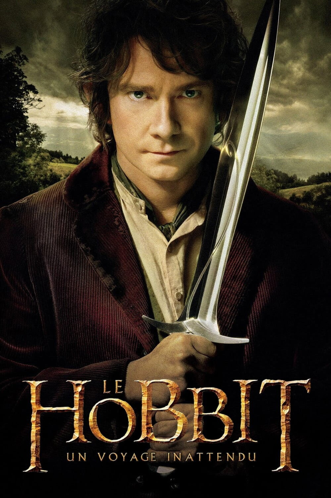<figcaption><em>Un voyage inattendu</em>, 2012</figcaption></figure>
  <figure>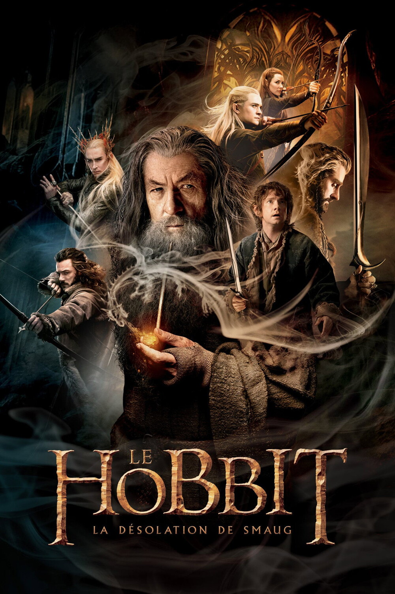<figcaption><em>La Désolation de Smaug</em>, 2013</figcaption></figure>
  <figure>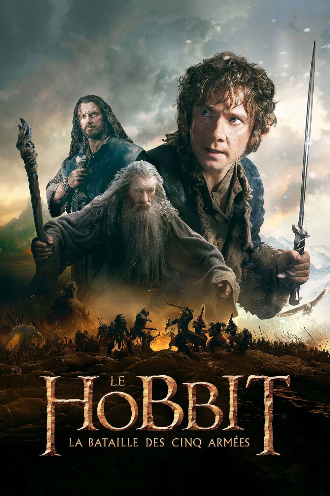<figcaption><em>La Bataille des cinq armées</em>, 2014</figcaption></figure>

<!--
Notes orateur : la trilogie du Hobbit, les trois films.
-->

---

<!-- _class: context dense -->

## Mais quel succès en tant qu'adaptation ?

> « Ils ont éviscéré le livre, en en faisant un film d'action pour les 15-25 ans », regrette Christopher. « Et il paraît que Le Hobbit sera du même acabit. »

> « Tolkien est devenu un monstre, dévoré par sa popularité et absorbé par l'absurdité de l'époque », observe tristement Christopher Tolkien. « Le fossé qui s'est creusé entre la beauté, le sérieux de l'œuvre, et ce qu'elle est devenue, tout cela me dépasse. Un tel degré de commercialisation réduit à rien la portée esthétique et philosophique de cette création. Il ne me reste qu'une seule solution : tourner la tête. »

— Christopher Tolkien, entretien au *Monde*, « Tolkien, l'anneau de la discorde », 5 juillet 2012

<!--
Notes orateur :
- Christopher Tolkien est le fils de l'écrivain.
- L'article est signé Raphaëlle Rérolle.
-->

---

<!-- _class: section -->

## Épilogue : Les Anneaux de pouvoir

---

<!-- _class: posters -->

## Série Amazon prévue en 5 saisons

  <figure>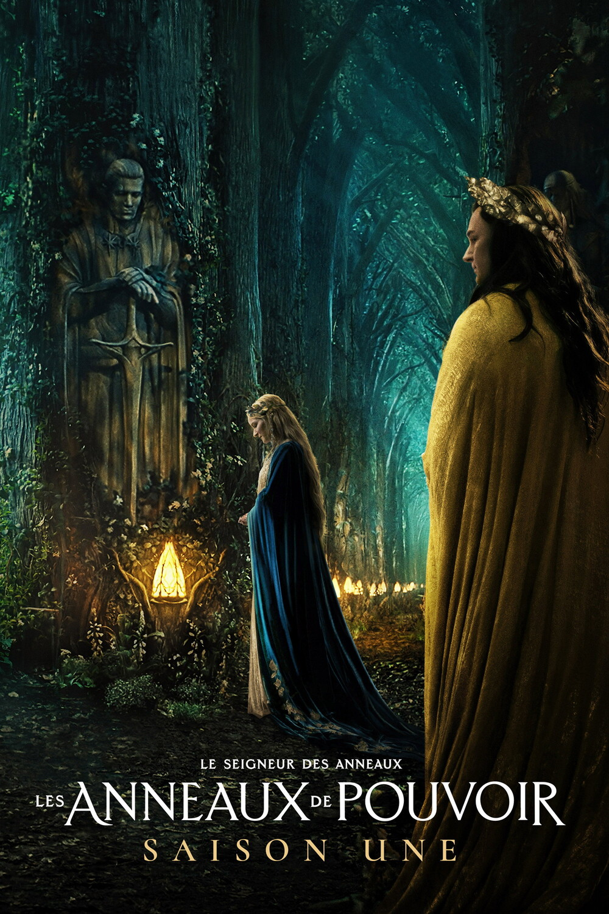<figcaption>Saison 1, 2022</figcaption></figure>
  <figure>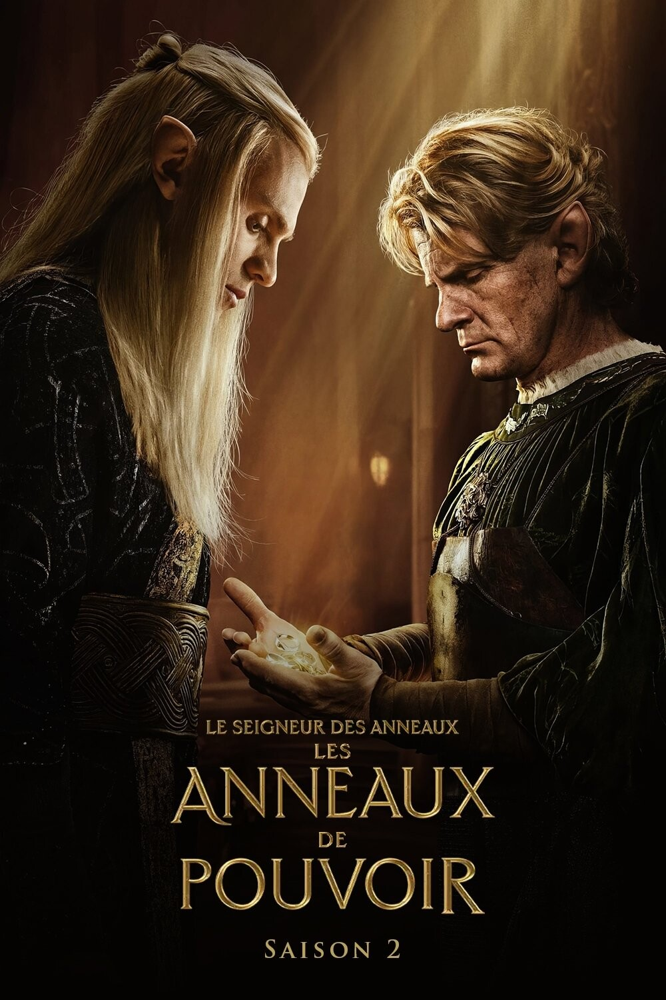<figcaption>Saison 2, 2024</figcaption></figure>
  <figure>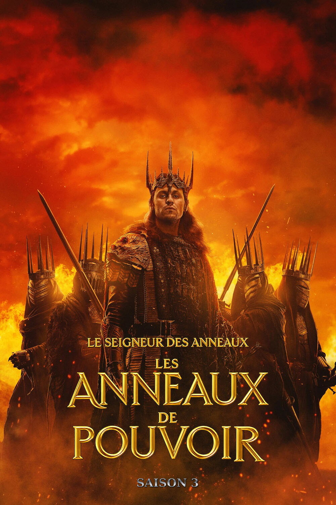<figcaption>Saison 3, 2026</figcaption></figure>

© Amazon Videos

<!--
Notes orateur : Les Anneaux de pouvoir, série Amazon prévue en 5 saisons ; affiches des 3 premières.
-->

---

<!-- _class: visual -->

## Les droits

<figure>
  
  <figcaption>Source : association Tolkiendil</figcaption>
</figure>

<!--
Notes orateur : l'image provient du site de l'association Tolkiendil.
-->
