<!-- _class: title -->
<!-- _paginate: false -->

# Tolkien, du livre à l'écran

Médiathèque de Salles · 27 novembre

<!--
Notes orateur : se présenter, remercier la médiathèque.
-->

---

<!-- _class: section -->

## 1. Le long chemin des livres vers les films

---

<!-- _class: dates -->
<!-- _transition: shrink 1.2s -->

## Tolkien en quelques dates

<figure class="photo">
  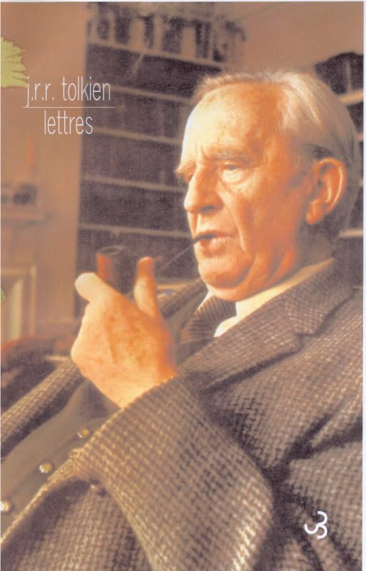
  <figcaption>Couverture de <em>Lettres</em>, J.R.R. Tolkien, éd. Christian Bourgois</figcaption>
</figure>

  

1892Naissance en Afrique du Sud

  

1937<em>Le Hobbit</em>

  

1954-1955<em>Le Seigneur des Anneaux</em>

  

1969Droits cédés à United Artists

  

1973Décès

<!--
Notes orateur (dates À VÉRIFIER et à reporter dans sources.md) :
- 3 janvier 1892 : naissance à Bloemfontein (Afrique du Sud).
- 21 septembre 1937 : parution du Hobbit.
- 1954-1955 : parution du Seigneur des Anneaux en trois volumes.
- 1969 : Tolkien cède les droits d'adaptation cinéma du Hobbit et du Seigneur des Anneaux à United Artists.
- 2 septembre 1973 : décès à Bournemouth (Angleterre).
Naissance, Hobbit et décès confirmés par Tolkiendil (« Tolkien, de l'homme à l'auteur »).
ATTENTION : Tolkiendil (« Le Guide Tolkien ») date la vente des droits de 1968, pas 1969.
-->

---

<!-- _class: crossing -->

<!-- Copie miniature de la slide précédente : à garder identique si elle change -->

<h2>Tolkien en quelques dates</h2>
<figure class="photo">
  
  <figcaption>Couverture de <em>Lettres</em>, J.R.R. Tolkien, éd. Christian Bourgois</figcaption>
</figure>

  

1892Naissance en Afrique du Sud

  

1937<em>Le Hobbit</em>

  

1954-1955<em>Le Seigneur des Anneaux</em>

  

1969Droits cédés à United Artists

  

1973Décès

<h2 class="heading">Et pendant ce temps, en Nouvelle-Zélande…</h2>

<!-- Positions calculées sur 1961-2001, à la même échelle que la frise de Tolkien -->

  

1961Naissance de Peter Jackson

  

1987<em>Bad Taste</em>

  

1994<em>Créatures célestes</em>

<figure class="jackson-photo">
  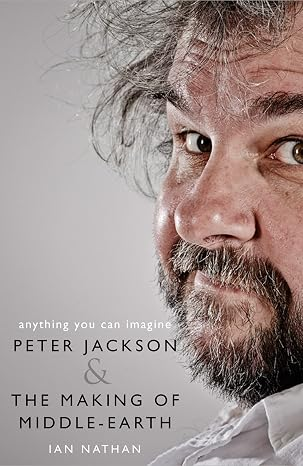
  <figcaption>Couverture de <em>Anything You Can Imagine</em>, Ian Nathan</figcaption>
</figure>

<svg class="junction" width="960" height="720" viewBox="0 0 960 720">
  <line class="guide" x1="373.7" y1="340" x2="373.7" y2="430" />
  <path class="draw" d="M430,283.5 L565,283.5 C595,283.5 585,360 615,360" />
  <path class="draw" d="M565,437 C595,437 585,360 615,360" />
  <path class="draw merged" d="M615,360 L920,360" />
  <g class="film-event">
    <circle cx="680" cy="360" r="8" />
    <text class="year" x="680" y="340">2001</text>
    <text class="film" x="680" y="392">La Communauté</text>
    <text class="film" x="680" y="412">de l'Anneau</text>
  </g>
  <g class="film-event">
    <circle cx="780" cy="360" r="8" />
    <text class="year" x="780" y="340">2002</text>
    <text class="film" x="780" y="392">Les Deux</text>
    <text class="film" x="780" y="412">Tours</text>
  </g>
  <g class="film-event">
    <circle cx="880" cy="360" r="8" />
    <text class="year" x="880" y="340">2003</text>
    <text class="film" x="880" y="392">Le Retour</text>
    <text class="film" x="880" y="412">du Roi</text>
  </g>
</svg>

<!--
Notes orateur :
- Peter Jackson naît le 31 octobre 1961 en Nouvelle-Zélande : il a 11 ans à la mort de Tolkien. (À VÉRIFIER)
- 1987 : Bad Taste, premier long métrage, film gore tourné en amateur. (À VÉRIFIER)
- 1994 : Créatures célestes (Heavenly Creatures), reconnaissance internationale. (À VÉRIFIER)
- Tournage simultané des trois films du 11 octobre 1999 au 22 décembre 2000 (Tolkiendil).
- Sorties en France : 19 décembre 2001, 18 décembre 2002, 17 décembre 2003 (Tolkiendil, page de la trilogie).
  ATTENTION : la page Tolkiendil des Deux Tours indique le 10 décembre 2002 pour la France.
-->

---

<!-- _class: context -->

## 1955 : le Seigneur des Anneaux à la radio

Première adaptation : un feuilleton radiophonique de la BBC.

> Je pense peu de bien des adaptations radiophoniques. À part quelques détails, je trouve qu'elles ne sont pas bien faites, même en admettant le script et la légitimité de l'entreprise (ce que, moi, je n'admets pas).

— J.R.R. Tolkien, lettre 176, 8 décembre 1955

<!--
Notes orateur :
- Première adaptation du Seigneur des Anneaux : un feuilleton radiophonique de la BBC, en 1955.
- Adaptation de Terence Tiller, diffusée en 1955-1956 (Tolkiendil). (À VÉRIFIER)
- Tolkien est déjà de son vivant très réservé sur l'idée même d'adapter son livre :
  il ne conteste pas seulement la qualité, il conteste la « légitimité de l'entreprise ».
- Citation : traduction par l'IA de l'original anglais (« which I do not grant »).
-->

---

<!-- _class: context -->

## 1957-1959 : un projet de dessin animé

Ackerman et Zimmerman proposent un film d'animation. Projet abandonné.

> Le Balrog ne parle jamais et n'émet absolument aucun son de voix. Surtout, il ne rit pas et ne ricane pas… Z peut bien penser qu'il en sait plus que moi sur les Balrogs, mais il ne peut pas s'attendre à ce que je sois d'accord avec lui.

— J.R.R. Tolkien, lettre 210

<!--
Notes orateur :
- 1957-1959 : projet de dessin animé porté par Ackerman et Zimmerman, finalement abandonné.
- Forrest Ackerman vient rencontrer Tolkien à Oxford pour présenter le projet (Tolkiendil). (À VÉRIFIER)
- « Z », c'est Morton Grady Zimmerman, l'auteur du scénario. Tolkien le commente point
  par point ; ici, sa remarque n° 20. (À VÉRIFIER)
- Touche d'humour : Tolkien corrige le scénariste sur… le comportement des Balrogs.
- Pourtant Tolkien n'était pas hostile à l'idée d'un dessin animé (citation C01) :
  « En ce qui me concerne, j'accueillerais personnellement volontiers l'idée d'un dessin
  animé, avec tous les risques liés à la vulgarisation [...] même si, à l'orée de la
  retraite, cela n'est pas une éventualité désagréable. »
- Citation de la lettre 210 : traduction par l'IA de l'original anglais.
-->

---

<!-- _class: long-quote -->

## 1969 : le projet avorté de John Boorman

> Boorman avait un goût pour le sensuel et le païen [...] Aragorn ranime Éowyn par un orgasme magique, et va même jusqu'à planter un franc baiser sur les lèvres de Boromir à un moment. Le réalisateur se laisse aussi emporter par la réputation du livre comme totem hippie. Les fleurs sauvages sont un leitmotiv omniprésent, et le Conseil d'Elrond se transforme en spectacle de cirque fellinien, avec danseurs, jongleurs et un chien plein d'entrain qui symbolise le destin. [...]
>
> Disparus, les trous de hobbit, Bree et le Gouffre de Helm. Gimli ouvre les portes de la Moria en dansant la gigue, tandis que Merry et Pippin sont joués comme un Laurel et Hardy version Demi-Hommes. [...]
>
> United Artists (UA) n'y comprit pas un traître mot.

— Ian Nathan, *Anything You Can Imagine* (2018)

<!--
Notes orateur :
- Projet de John Boorman en 1969 : les trois livres condensés en un seul film.
- Lire l'extrait à voix haute : l'effet comique tient à l'accumulation (le baiser à Boromir,
  la gigue de Gimli, Merry et Pippin en Laurel et Hardy, le chien qui symbolise le destin).
- Chute : United Artists n'y comprend rien, le projet est abandonné.
-->

---

## Et les Beatles ?

- Les Beatles veulent une comédie musicale tirée du *Seigneur des Anneaux*, dont ils seraient les vedettes
- Ils vont trouver Stanley Kubrick
- Kubrick les aurait convaincus que le livre est inadaptable

<!--
Notes orateur (Ian Nathan, Anything You Can Imagine) :
« Puis il y avait l'histoire des Beatles. Comment les Fab Four, au sommet de leur propre
gloire invraisemblable, étaient allés trouver le grand Stanley Kubrick dans sa propriété
de St Albans pour qu'il les aide à créer une comédie musicale multimédia tirée du
Seigneur des Anneaux, dont ils seraient les vedettes et dont ils assureraient,
naturellement, la rythmique. »
- Il semblerait que Kubrick ait convaincu les Beatles de l'impossibilité de l'adaptation.
-->

---

## 1978 : la première tentative

  

1969United Artists

  

Boormanabandon

  

MGMabandon

  

Saul Zaentzrachète

  

1978sortie du film

  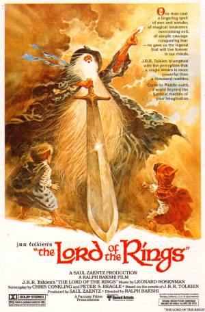
  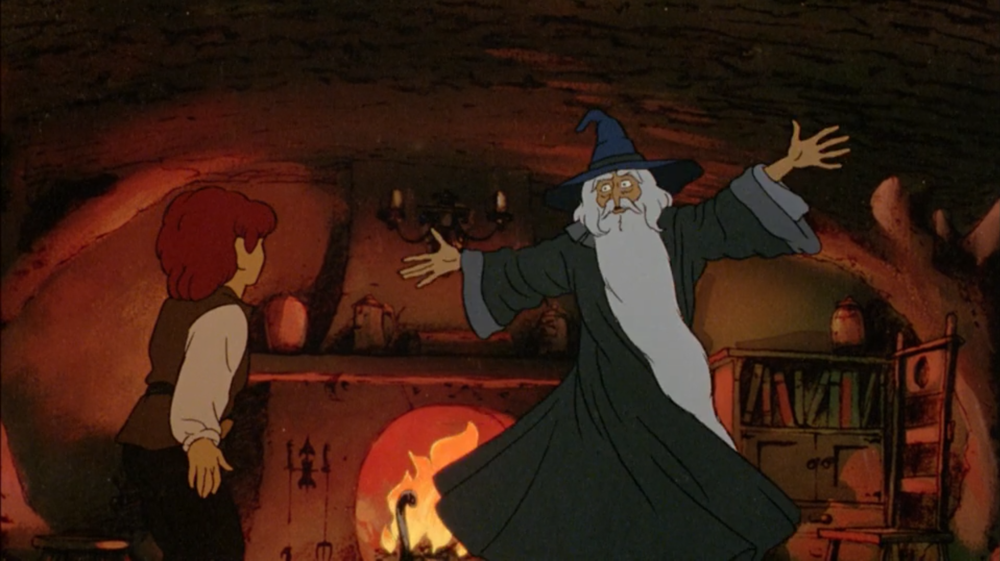

Tourné avec des acteurs, puis redessiné à la main

<!--
Notes orateur :
- Message : adapter Tolkien au cinéma était déjà un pari risqué, et le parcours du film le montre.
- Bakshi lit dans la presse que United Artists prépare une version de John Boorman qui
  condense les trois livres en un film. Pour lui, « la chose la plus stupide » qu'il ait
  entendue. United Artists abandonne : le patron du studio avoue n'avoir « jamais lu le
  bouquin » et veut surtout récupérer les 3 millions de dollars payés pour le scénario.
- Bakshi convainc la MGM le jour même, puis le dirigeant de la MGM est licencié. Son
  successeur : « Je ne comprends pas le film » et demande si l'histoire « parle d'un
  mariage ».
- Saul Zaentz (producteur enrichi par Fritz le Chat, plus tard Vol au-dessus d'un nid de
  coucou) rachète tout pour financer « les trois films ». United Artists distribue.
- Bakshi va chercher la bénédiction de la famille : Priscilla Tolkien lui fait visiter le
  bureau de son père à Oxford.
- Technique : tout est d'abord tourné avec des acteurs costumés (plateau blanc à
  Los Angeles, château de Belmonte en Espagne pour le Gouffre de Helm), puis redessiné
  (rotoscopie). Pas d'ordinateur à l'époque.
- Anecdotes : Mick Jagger voulait faire la voix de Frodon ; Led Zeppelin était d'accord
  pour la musique, mais un problème de contrat l'a empêché ; les figurants espagnols
  jouant les orques partent manger en pleine prise.
- Bakshi : « J'en suis presque mort. C'était la chose la plus dure que j'ai faite de toute
  ma vie. » (citation candidate C-B1, absente de citations.md)
-->

---

## Un succès inachevé

- L'histoire s'arrête au Gouffre de Helm
- « Première partie » : retiré de l'affiche
- La suite ne sera jamais tournée

Christopher Tolkien la considère : « avec horreur, telle une incroyable parodie du travail de mon père ». Cité par Adam Tolkien (source : Tolkiendil)

<!--
Notes orateur :
- Bakshi demandait 3 ou 4 mois de plus pour le montage ; refusé, la sortie avant Noël était
  fixée. Il considère le film comme « une grossière première ébauche ».
- Une semaine avant la sortie, il découvre que la mention « Première partie » a disparu de
  la campagne de publicité. Le film se termine après le Gouffre de Helm : les spectateurs
  ne voient jamais Frodon détruire l'Anneau, les fans se sentent floués, les autres
  restent perplexes.
- Les critiques sont sévères : film jugé confus, rotoscopie vue comme une « triche ».
  Christopher Tolkien considère le film « avec horreur, telle une incroyable parodie du
  travail de mon père ».
- Pas de suite : Bakshi se brouille avec Zaentz et refuse de faire la deuxième partie ;
  selon une autre source, United Artists refuse de financer une suite malgré le succès.
  Les deux versions sont compatibles.
- En 1980, un téléfilm d'animation de Rankin et Bass, The Return of the King, raconte la
  fin, présenté comme une suite non officielle, avec un style graphique totalement
  différent. (À VÉRIFIER)
- Transition vers Jackson : les leçons de cet échec (une histoire en trois films, tournés
  d'un bloc, sans sortie bâclée). (À VÉRIFIER : interprétation à valider par l'auteur)
-->

---

<!-- _class: section -->

## 2. La carrière de Peter Jackson

---

## Un bricoleur de génie

- Enfant : une caméra Super 8 et *King Kong*
- 1987 : *Bad Taste*, tourné le week-end, entre amis
- Masques et effets fabriqués à la maison

  

<!--
Notes orateur :
- Message : dès l'enfance, Jackson fabrique lui-même ses effets spéciaux, avec trois fois rien.
- Né en 1961 en Nouvelle-Zélande (déjà sur la slide « croisement »). Enfant, il reçoit une
  caméra Super 8 et tourne ses propres films avec les copains du quartier. (À VÉRIFIER)
- Le déclic : King Kong (1933), vu enfant à la télévision ; il tente d'en tourner sa
  propre version, avec un gorille en maquette. Son admiration pour Ray Harryhausen,
  maître de l'animation image par image. (À VÉRIFIER)
- Pas d'école de cinéma : il quitte l'école et travaille comme photograveur dans un journal
  de Wellington. (À VÉRIFIER)
- Bad Taste (1987) : film d'extraterrestres gore et comique, tourné pendant environ
  quatre ans, les week-ends, avec des amis. Jackson joue deux rôles, et cuit les masques
  en latex dans le four de sa mère. (À VÉRIFIER) Touche d'humour.
- Le film est remarqué au marché du Festival de Cannes (1988) et vendu dans de nombreux
  pays. (À VÉRIFIER)
- Citation candidate C-J1 (absente de citations.md) : Jackson dit que filmer des maquettes
  est l'un des grands plaisirs, et que dans une autre carrière il construirait des
  maquettes pour le cinéma (American Cinematographer).
-->

---

## Weta, l'atelier maison

- Richard Taylor et Tania Rodger : maquettes, prothèses, costumes
- *Les Feebles* (1989), *Braindead* (1992)
- *Créatures célestes* (1994) : naissance de Weta Digital
- *Fantômes contre fantômes* (1996)

<!--
Notes orateur :
- Message : autour de Jackson naît une petite entreprise d'effets spéciaux qui deviendra
  l'une des meilleures du monde.
- Weta Workshop est fondée par Richard Taylor et Tania Rodger, spécialisée dans les
  prothèses, maquettes, animatroniques et costumes.
- Le nom : « Wingnut Entertainment Technical Allusions », et surtout le weta, un insecte
  néo-zélandais particulièrement résistant.
- Premier projet avec Jackson : Braindead, repoussé faute de financement ; entre-temps,
  ils travaillent sur Les Feebles (1989), comédie avec des marionnettes, qualifiée de l'un
  des films « les plus gores » jamais tournés. Braindead sort finalement en 1992. (À VÉRIFIER)
- Weta travaille aussi pour la télévision : Hercule et Xena, la princesse guerrière (1995).
- Créatures célestes (1994), drame coécrit avec Fran Walsh, d'après un fait divers :
  changement de registre complet, reconnaissance internationale. Pour ses effets
  numériques est créée Weta Digital. Premier rôle au cinéma de Kate Winslet ; nomination à
  l'Oscar du meilleur scénario original. (À VÉRIFIER)
- Fantômes contre fantômes (The Frighteners, 1996), produit par un studio hollywoodien
  (Universal), avec Michael J. Fox : des centaines de plans numériques, réalisés en
  Nouvelle-Zélande. (À VÉRIFIER, sauf la participation de Weta) C'est la répétition
  générale du Seigneur des Anneaux.
- Fran Walsh, sa compagne, coscénariste de presque tous ses films, coscénariste de la
  trilogie et oscarisée avec lui. (À VÉRIFIER, sauf l'Oscar)
- Pour la suite : sur la trilogie, Weta prendra en charge les miniatures, les armes et
  armures, les créatures, les prothèses et le maquillage, et Richard Taylor remportera
  plusieurs Oscars (effets visuels, maquillage, costumes).
-->

---

## Pourquoi pas Tolkien ?

  

1978il voit le film de Bakshi, puis lit le livre

  

1996<em>King Kong</em> : projet annulé

  

Weta est prêtepourquoi pas Tolkien ?

  

<!--
Notes orateur :
- Message : Jackson arrive au Seigneur des Anneaux par deux chemins : un souvenir de
  jeunesse (le film de Bakshi) et un projet avorté (King Kong).
- Adolescent, Jackson voit le film de Ralph Bakshi en 1978, veut savoir comment l'histoire
  finit, et achète le livre en poche pour le lire dans le train. (À VÉRIFIER)
  Lien direct avec « Un succès inachevé » : la fin manquante du film de Bakshi a poussé le
  futur réalisateur vers le livre.
- Weta fait un important travail de préproduction pour un remake de King Kong ; le projet
  est annulé, notamment à cause de la concurrence du Godzilla de 1998. Jackson le
  réalisera après la trilogie (2005).
- Aussitôt après, Jackson propose à Weta un nouveau projet : Le Seigneur des Anneaux.
  Pour l'obtenir, il faut passer par Saul Zaentz, qui détient toujours les droits depuis
  le film de Bakshi. (À VÉRIFIER) Encore un écho avec la partie précédente.
- Transition : Miramax, deux films, puis un seul, puis New Line et la trilogie.
-->

---

<!-- _class: section -->

## 3. Le tournage

---

<!-- _class: cameos -->

<h2>Alan Lee et John Howe à l'écran</h2>

<figure class="portrait left">
  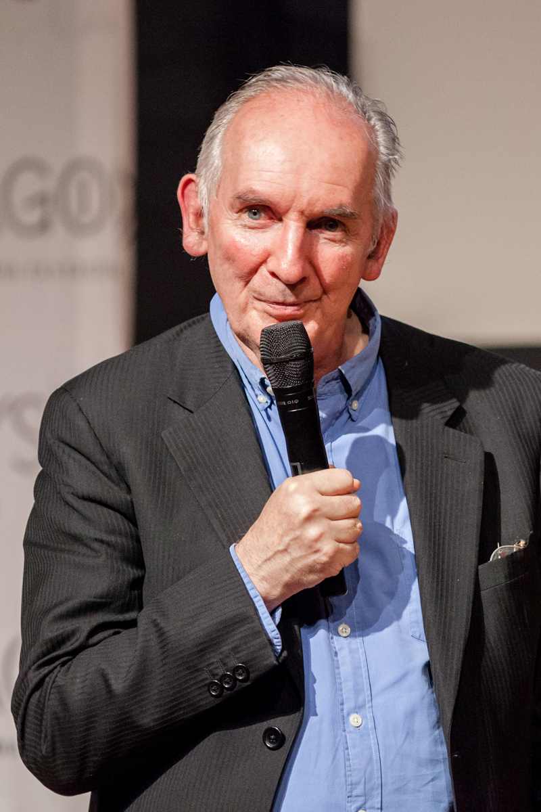
  <figcaption>Alan Lee</figcaption>
</figure>

<figure class="portrait right">
  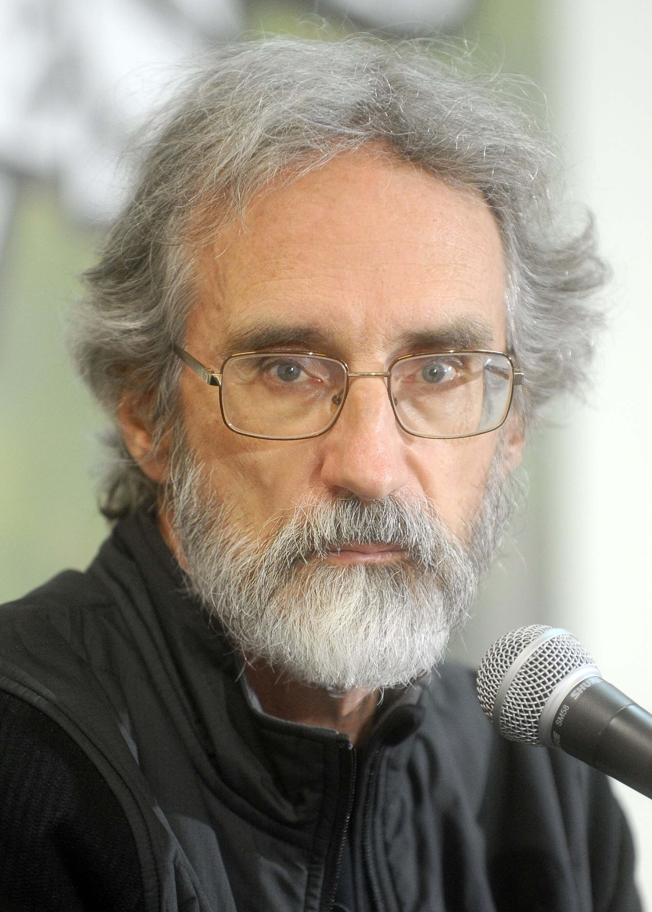
  <figcaption>John Howe</figcaption>
</figure>

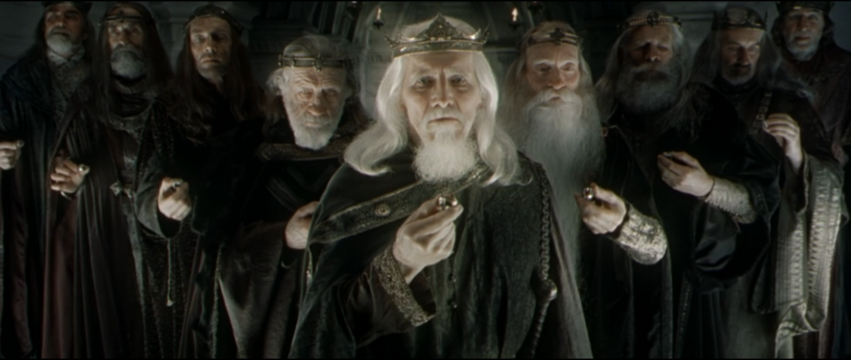

<!-- Coordonnées : image 951×403 affichée en 840×356 à (60, 340), soit un facteur 0,883 -->
<svg class="arrows" width="960" height="720" viewBox="0 0 960 720">
  <defs>
    <marker id="arrowhead" markerUnits="userSpaceOnUse" markerWidth="14" markerHeight="14" refX="12" refY="7" orient="auto">
      <path d="M0,0 L14,7 L0,14 Z" />
    </marker>
  </defs>
  <circle cx="188" cy="397" r="42" />
  <circle cx="793" cy="389" r="42" />
  <path d="M150,272 C150,310 185,310 188,350" marker-end="url(#arrowhead)" />
  <path d="M825,272 C825,305 795,305 793,342" marker-end="url(#arrowhead)" />
</svg>

<!--
Notes orateur :
- Dans le prologue de La Communauté de l'Anneau, parmi les neuf rois des Hommes qui
  reçoivent leurs anneaux : Alan Lee (2e en partant de la gauche) et John Howe
  (2e en partant de la droite).
-->

---

## Cul-de-Sac

  <figure>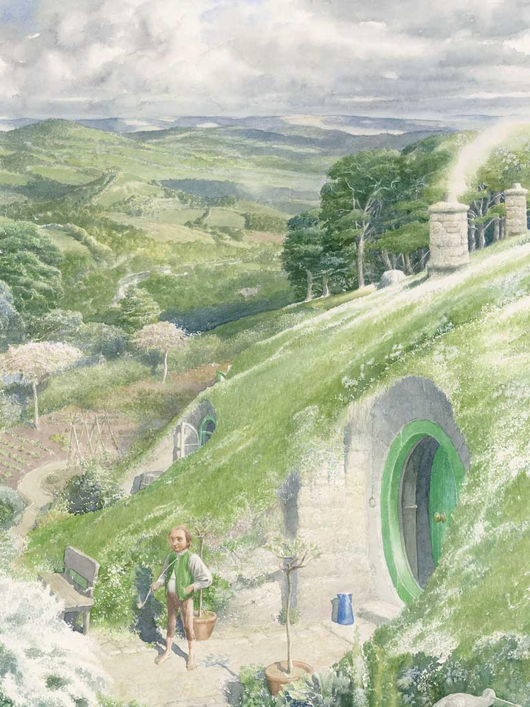<figcaption>Alan Lee</figcaption></figure>
  <figure>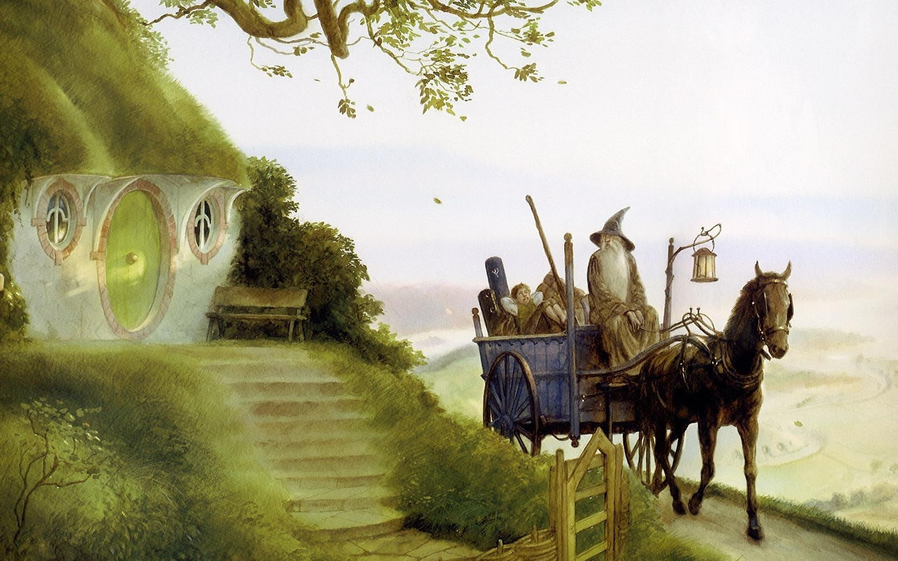<figcaption>John Howe</figcaption></figure>
  <figure>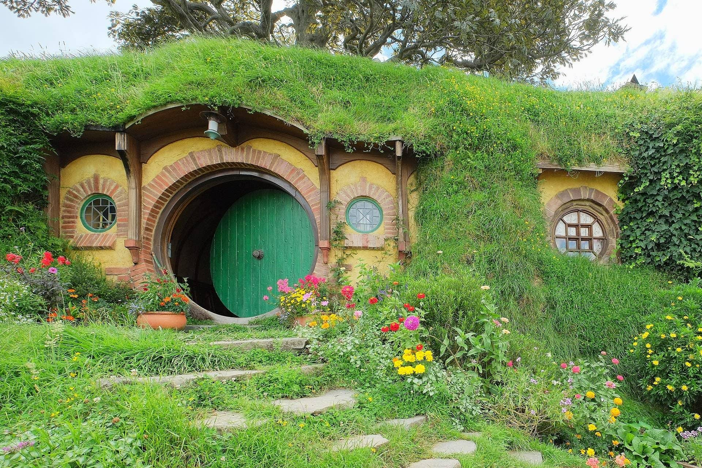<figcaption>Le film</figcaption></figure>

<!--
Notes orateur : la même porte ronde, de l'illustration au décor.
-->

---

## Minas Tirith

  <figure>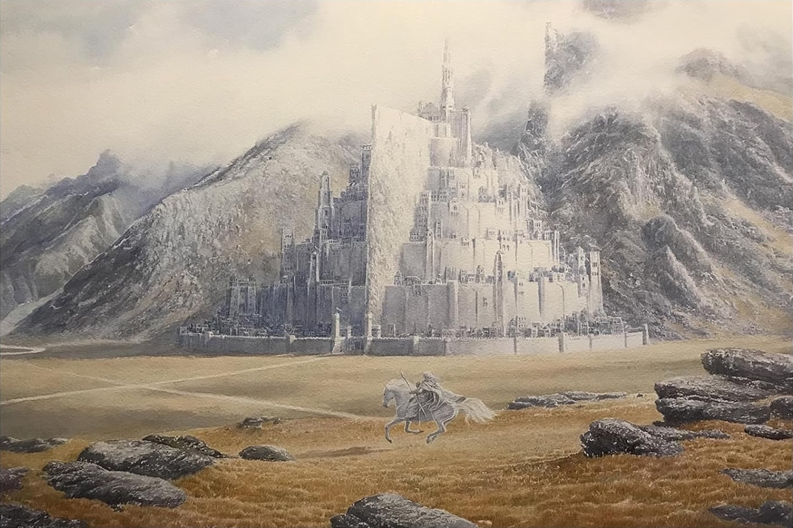<figcaption>Alan Lee</figcaption></figure>
  <figure>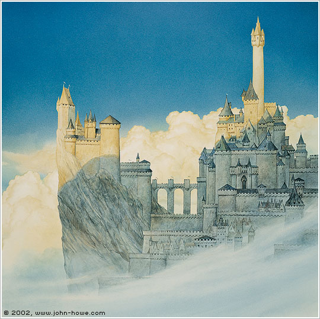<figcaption>John Howe</figcaption></figure>
  <figure>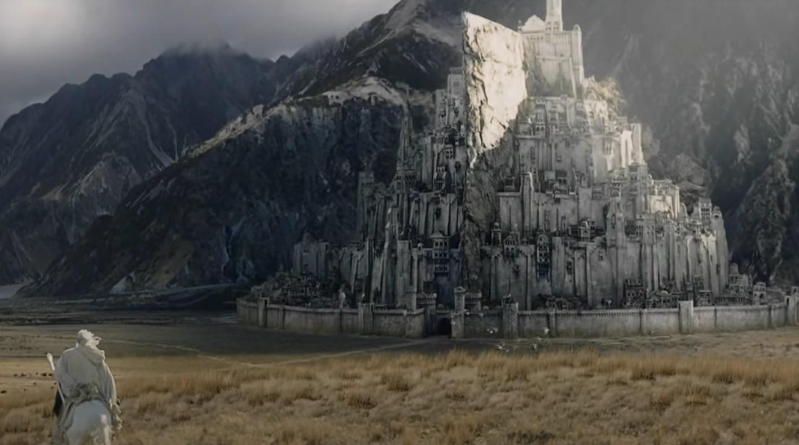<figcaption>Le film</figcaption></figure>

<!--
Notes orateur : Minas Tirith vue par Alan Lee, par John Howe, puis dans le film.
-->
